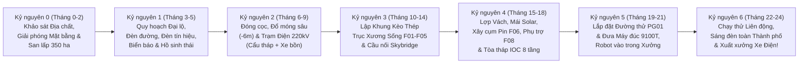
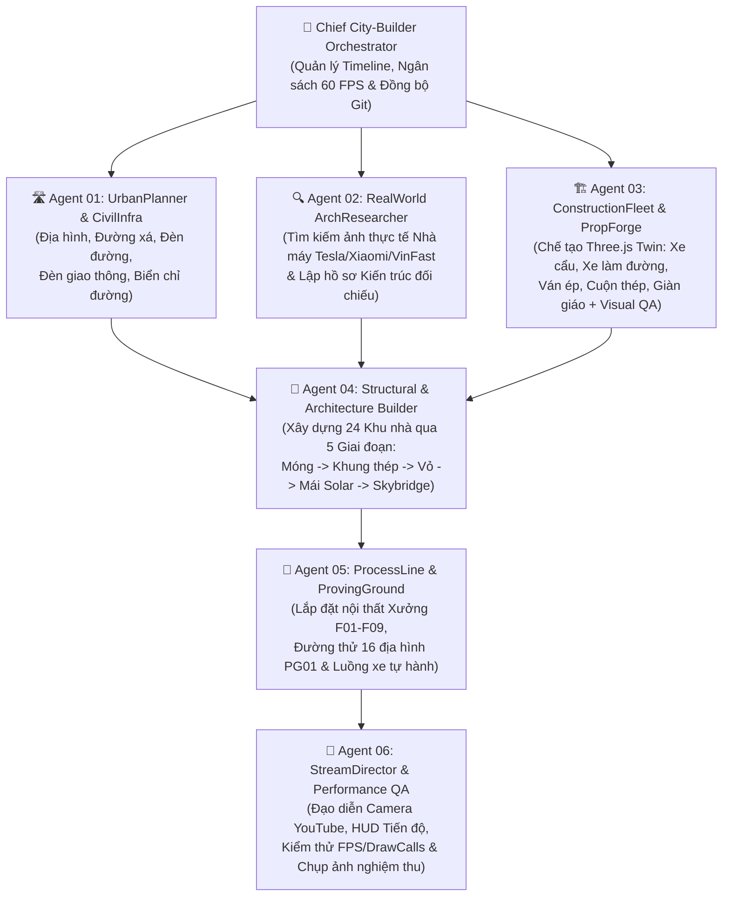

# KỊCH BẢN PHÁT TRIỂN ĐÔ THỊ CÔNG NGHIỆP & KẾ HOẠCH TRIỂN KHAI ĐA TÁC NHÂN (AGENTIC CITY-BUILDER MASTER PLAN)
## Dự án: Tổ Hợp EV Gigafactory 350 Ha — Mô Phỏng Toàn Trình Từ Khu Đất Trống Đến Siêu Nhà Máy Hoạt Động (YouTube Live-Stream Ready)

> [!IMPORTANT]
> **Triết lý Cốt lõi ("Industrial City-Builder & Construction Time-Lapse Engine")**:
> Thay vì chỉ hiển thị một nhà máy tĩnh đã xây xong, kế hoạch này biến dự án `AutoForge3D` thành một **Kịch bản Phát triển Thành phố Công nghiệp 350 ha sống động theo thời gian thực** (lấy cảm hứng từ *Cities: Skylines*, *Workers & Resources*, và *Timelapse xây dựng Tesla Gigafactory Shanghai/Berlin & VinFast Hải Phòng*).
> - Mọi giai đoạn đều **độc lập về mặt kiến trúc code**, **tối ưu hóa hiệu năng (60 FPS với 100% Three.js Twin + InstancedMesh)** và **tự động kiểm chứng ngoại quan bằng hình ảnh thực tế + chụp ảnh Puppeteer QA**.
> - Hỗ trợ chế độ **🎬 YouTube Construction Streamer Mode**: Camera đạo diễn tự động bay lượn quanh đại công trường, theo dõi từng đoàn xe ủi san lấp, xe lu làm đường, cẩu tháp lắp dựng khung kèo thép, cho đến khi 24 phân khu sáng đèn và những chiếc xe điện đầu tiên lăn bánh ra đường thử `PG01`.

---

## PHẦN 1: KIẾN TRÚC PHÂN TẦNG ĐỘC LẬP & QUY TẮC TỐI ƯU CODE QUA TỪNG GIAI ĐOẠN

Để nhiều Agent có thể làm việc song song hoặc nối tiếp nhau mà không gây xung đột code (merge conflict) hay sụt giảm FPS khi quy mô tăng gấp 50 lần, mã nguồn trên nhánh `feat/ev-gigafactory-city-builder` được tổ chức theo cấu trúc **Micro-Builder Modules**:

```text
src/
├── gigafactory/
│   ├── config/
│   │   ├── masterSpecLoader.js          # Đọc gigafactory_digital_twin_spec.json & chuyển đổi tọa độ
│   │   └── constructionStagesSpec.js    # Cấu hình 7 Kỷ nguyên xây dựng (Epochs M00 -> M24)
│   ├── core/
│   │   ├── worldGridManager.js          # Quản lý địa hình 2500m x 1400m, chia 56 Sector (250x250m)
│   │   ├── instancedPool.js             # Quản lý gom nhóm InstancedMesh toàn cục (đèn, cây, cột thép, cẩu)
│   │   ├── constructionTimeline.js      # Bộ điều khiển thời gian EPC (Scrubber, Play/Pause, Speed 1x..100x)
│   │   └── streamDirector.js            # Đạo diễn Camera tự động (Drone Orbit, Crane Cam, Street Cam, HUD)
│   ├── infra/                           # [AGENT 01] Hạ tầng Đô thị & Giao thông
│   │   ├── terrainAndEarthwork.js       # Địa hình, hồ điều hòa, nền đất san lấp, cọc ranh giới
│   │   ├── roadNetworkBuilder.js        # Đường đại lộ 6 làn, đường nội khu, vạch kẻ, vòng xuyến, vỉa hè
│   │   └── trafficPropsBuilder.js       # Đèn đường, đèn giao thông 3 màu, biển chỉ đường, trạm gác, rào chắn
│   ├── assets/                          # [AGENT 03] Thư viện 3D Three.js Twin Công trường & Vật tư
│   │   ├── heavyMachineryTwins.js       # Cẩu tháp, Cẩu bánh xích, Xe ủi, Xe lu, Máy xúc, Xe bồn bê tông
│   │   └── constructionMaterialsTwins.js# Ván ép cốt pha, Cuộn thép, Dầm chữ I, Cọc bê tông, Giàn giáo, Container
│   ├── builders/                        # [AGENT 04] Kiến trúc 24 Khu nhà qua 5 Trạng thái Xây dựng
│   │   ├── stageRenderer.js             # Render tòa nhà theo % tiến độ (Móng -> Khung thép -> Mái/Vách -> Hoàn thiện)
│   │   ├── spineFactoriesBuilder.js     # F01 (Đúc), F02 (Dập), F03 (Hàn BIW), F04 (Sơn 3 tầng), F05 (Lắp ráp chữ E)
│   │   ├── northEnergyBatteryBuilder.js # F06A (Cell Pin), F06B (Pack Pin), F07 (E-Axle), UT01..UT04
│   │   ├── southSupplierRdBuilder.js    # WH01 (Kho AS/RS), F08-1..5 (Phụ trợ), IOC01 (8 tầng), RD01, UT05
│   │   ├── eastTestingYardBuilder.js    # F09 (EOL), PG01 (Đường thử 16 địa hình), LY01 (Bãi xe mái Solar)
│   │   └── skybridgesBuilder.js         # 5 Cầu băng tải trên cao SB-01..SB-05 (cao độ +8.5m đến +14m)
│   └── qa/                              # [AGENT 02 & 06] Công cụ Đối chiếu Thực tế & Visual QA
│       ├── referenceCatalog.json        # Link ảnh & thông số kiến trúc thực tế (Tesla, Xiaomi, VinFast)
│       └── visualAuditRunner.cjs        # Script Puppeteer tự động chụp ảnh từng Sector & kiểm tra FPS/DrawCalls
```

### Quy tắc Tối ưu Hiệu năng Bắt buộc cho Mọi Giai đoạn (Performance Guardrails)
1. **Ngân sách Đa giác (Polygon Budget)**:
   - Toàn cảnh Tổ hợp 350 ha (Overview): `< 450.000 triangles` toàn khung hình, `< 350 Draw Calls`.
   - Mỗi phương tiện/vật tư xây dựng Three.js Twin: `150 – 2.500 triangles`.
   - Mỗi tòa nhà ở chế độ ngoại thất (Exterior Shell + Rooftop Solar/HVAC): `800 – 4.500 triangles`.
2. **Bắt buộc dùng `THREE.InstancedMesh` cho vật thể lặp lại**:
   - Đèn đường (`~600 cột`), biển báo giao thông (`~180 biển`), đèn tín hiệu (`~32 cụm`), cây xanh (`~2.000 cây`), cột khung thép nhà xưởng (`~1.400 cột H-beam`), tấm pin mặt trời áp mái, cọc móng bê tông, giàn giáo, cuộn thép, pallet ván ép **phải** đăng ký qua `instancedPool.js` (chỉ tốn 1 Draw Call cho mỗi loại vật liệu).
3. **Cơ chế Culling theo Phân khu (Sector & Distance Culling)**:
   - Máy móc bên trong xưởng (`F01..F09`) và chi tiết nhỏ công trường chỉ hiển thị khi camera bay vào gần (`distance < 350m`) hoặc khi người dùng bật chế độ **X-Ray / Mở mái nhà xưởng (Roof Cutaway)**.

---

## PHẦN 2: KỊCH BẢN 7 KỶ NGUYÊN XÂY DỰNG THÀNH PHỐ CÔNG NGHIỆP (7 CONSTRUCTION EPOCHS)

Giống như một bộ phim tài liệu xây dựng siêu dự án (hoặc kênh stream xây dựng thành phố), toàn bộ quá trình hình thành Gigafactory 350 ha được chia thành **7 Kỷ nguyên (Epochs)** liên tục:



### Chi tiết từng Kỷ nguyên để Stream / Mô phỏng:

| Kỷ nguyên | Tên Giai Đoạn | Những gì diễn ra trên Màn hình 3D (Visual Storytelling) | Các phương tiện & Vật tư xuất hiện |
|---|---|---|---|
| **Epoch 0** (`0%–12%`) | **Khảo sát & San lấp Địa hình (`Survey & Earthwork`)** | Khu đất 350 ha ban đầu có địa hình tự nhiên; lưới tọa độ Laser xuất hiện đóng cọc phân lô 24 khu đất; đào kênh thoát nước & hồ điều hòa; xe ủi, máy xúc, xe lu san phẳng các lô nhà xưởng chính. | Cọc mốc trắc địa, hàng rào công trường tôn xanh, Xe ủi (`Bulldozer`), Máy xúc (`Excavator`), Xe ben chở đất (`Dump Truck`), Xe lu (`Road Roller`). |
| **Epoch 1** (`12%–25%`) | **Hạ tầng Giao thông & Đô thị (`Civil & Road Network`)** | Trải nhựa Đại lộ Nam-Bắc và Đông-Tây 6 làn xe; kẻ vạch phân làn trắng/vàng; dựng hệ thống đèn đường cao áp, đèn tín hiệu giao thông ngã tư, biển chỉ dẫn xanh dương tới từng phân khu (`F01..F09`), cổng chào Logistics phía Tây & cổng R&D phía Nam. | Xe rải thảm nhựa (`Asphalt Paver`), Xe lu rung, Cột đèn đường LED, Cụm đèn tín hiệu giao thông, Biển báo giao thông, Cổng trạm cân xe tải. |
| **Epoch 2** (`25%–42%`) | **Thi công Móng sâu & Trạm Năng lượng (`Foundations & Power Grid`)** | Đào hố móng sâu `-6m` tại Xưởng Dập `F02` và bệ móng chịu tải `60 tấn/m²` cho 6 Đảo đúc `F01`; hàng ngàn đầu cọc bê tông nhô lên; ghép ván ép cốt pha (`Plywood Formwork`), đan lồng thép; xe trộn bê tông và xe bơm cần dài đổ móng; dựng trước Trạm biến áp 220kV (`UT01`) để cấp điện công trường. | Máy đóng cọc (`Pile Driver`), Xe trộn bê tông (`Concrete Mixer`), Xe bơm bê tông, Chồng ván ép cốt pha, Lồng thép chờ, Bãi tập kết cuộn thép & ống cống. |
| **Epoch 3** (`42%–62%`) | **Dựng Đại Khung Thép Trục Xương Sống (`Mega Steel Erection`)** | 18 Cẩu tháp (`Tower Cranes`) cao 45m–60m và 12 Cẩu bánh xích (`Crawler Cranes`) quay tấp nập; lắp dựng lưới cột thép chữ H (`24×30m`) và dàn vì kèo mái không gian cho trục `F01 -> F05`, `WH01` (cao 32m) và bắc 5 nhịp cầu thép `Skybridge SB-01..05` băng qua đường lớn. | Cẩu tháp (`Tower Crane`), Cẩu bánh xích (`Crawler Crane`), Xe đầu kéo chở dầm thép siêu trường, Khung cột/dầm thép sơn chống rỉ đỏ/xám, Giàn giáo (`Scaffolding`). |
| **Epoch 4** (`62%–80%`) | **Hoàn thiện Vỏ Kiến trúc, Tháp IOC & Mái Năng lượng (`Envelope & Architectural Skin`)** | Lợp tấm vách cách nhiệt kim loại bạc/trắng có dải màu nhận diện thương hiệu từng xưởng; lắp vách kính Curtain Wall xanh cho Tòa nhà Điều hành `IOC01` (8 tầng) và Viện `RD01`; phủ `820.000 m²` tấm Pin mặt trời áp mái (`120 MWp`); lắp đặt tháp giải nhiệt Chiller (`UT02`), bồn khí Cryo đứng (`UT03`) và bể xử lý nước tròn (`UT04`). | Xe nâng người cắt kéo (`Scissor Lift`), Xe cẩu tự hành (`Mobile Telescopic Crane`), Tấm Panel vách, Bó tấm Pin mặt trời, Bồn khí N2/Ar, Tháp Chiller. |
| **Epoch 5** (`80%–92%`) | **Thi công Đường thử 16 Địa hình & Lắp đặt Dây chuyền (`Proving Ground & Equipment Fit-out`)** | Hoàn thiện vòng đua tốc độ cao nghiêng góc Parabol tại `PG01` (gồm đường đá Bỉ, cầu dốc 30%, máng lội nước); cẩu tháp tháo dỡ dần; đoàn xe siêu trường chở 6 máy đúc Giga-Press 9.100T, máy dập Schuler và hàng ngàn kiện robot ABB/KUKA đi vào cổng xưởng. | Xe siêu trường chở máy đúc (`Heavy Lowboy Trailer`), Xe nâng hàng (`Forklift Twin`), Kiện gỗ máy móc, Cuộn tôn/nhôm nguyên liệu (`Steel/Aluminum Coils`). |
| **Epoch 6** (`92%–100%`) | **Vận hành Toàn trình Siêu Nhà máy (`Full Digital Twin Operation`)** | Công trường thu dọn sạch sẽ; 2.000 cây xanh và thảm cỏ phủ xanh hành lang sinh thái; đèn đường và đèn tín hiệu điều tiết giao thông; 850 AMR/AGV và xe đầu kéo chạy tấp nập; thân xe chạy qua cầu kính Skybridge; xe điện thành phẩm tự hành lăn bánh từ `F05 -> F09 -> chạy thử trên vòng đua PG01 -> đỗ vào bãi Solar LY01`. | Toàn bộ đội xe Điện (SUV, Sedan, MPV), Đội xe AGV/AMR, Xe đầu kéo Container, Robot công nghiệp, Hệ thống chiếu sáng đêm. |

---

## PHẦN 3: THIẾT KẾ ĐỘI NGŨ AGENT CHUYÊN BIỆT (MULTI-AGENT SQUAD ARCHITECTURE)

Mỗi Agent trong đội ngũ được thiết kế với **nhiệm vụ độc lập**, **công cụ tra cứu/kiểm chứng rõ ràng**, và **giao diện dữ liệu chuẩn** để bạn có thể chạy từng Agent một hoặc chạy song song bằng `/teamwork`:



### Đặc tả Chi tiết Từng Agent:

#### 1. `Agent 01`: Quy hoạch Khu đất & Hạ tầng Đô thị (`UrbanPlanner_CivilInfra_Agent`)
* **Nhiệm vụ**:
  - Đọc `gigafactory_digital_twin_spec.json` (`2500m × 1400m`), tạo mặt phẳng địa hình phân lớp: Đất tự nhiên, Nền bê tông phân khu, Hành lang cây xanh (`25.8%` diện tích) và Hồ điều hòa sinh thái.
  - Quy hoạch mạng lưới đường giao thông nội khu tránh hoàn toàn 24 footprint tòa nhà:
    - **Đại lộ Nam (Main South Boulevard, `Y = 30m..65m`)**: 6 làn xe có dải phân cách trồng cây, nối cổng chính tới `IOC01`, `RD01`, `PG01`.
    - **Trục Logistics Tây (`X = 25m..65m`)**: Tuyến xe đầu kéo hạng nặng chở cuộn thép, nhôm thỏi vào `WH01`, `F02`, `F01`, `UT01`.
    - **2 Đại lộ Xương sống Đông-Tây (`Y = 415m..445m` và `Y = 950m..990m`)**: Chạy dưới gầm 5 cầu `Skybridge`.
    - **3 Trục Kết nối Bắc-Nam (`X = 400m`, `X = 1010m`, `X = 1470m`, `X = 2175m`)**: Tạo thành mạng lưới ô bàn cờ chuẩn công nghiệp.
  - Dựng hạ tầng giao thông chi tiết bằng `InstancedMesh`:
    - **Đèn đường cao áp đôi & đơn** dọc các trục đường (tự động bật sáng khi chuyển chế độ Chiều/Đêm).
    - **Đèn tín hiệu giao thông 3 màu (Đỏ-Vàng-Xanh)** tại 12 ngã tư chính (có chu kỳ đổi đèn thực tế).
    - **Biển báo chỉ dẫn phân khu (Wayfinding Signage)** kiểu cổng long môn & biển cột xanh phản quang ghi rõ hướng đi (`⬅️ F01 GIGA-CASTING | ⬆️ F06 BATTERY CELL | ➡️ F05 GENERAL ASSEMBLY`).
    - **Vạch kẻ đường, lối đi bộ sang đường (Zebra crossing), vòng xuyến, rào chắn hộ lan tôn lượn sóng, trạm gác an ninh & barie tự động**.
* **File đầu ra độc lập**: `src/gigafactory/infra/terrainAndEarthwork.js`, `src/gigafactory/infra/roadNetworkBuilder.js`, `src/gigafactory/infra/trafficPropsBuilder.js`.

#### 2. `Agent 02`: Nghiên cứu Thực tế & Kiến trúc Đối chiếu (`RealWorld_ArchResearcher_Agent`)
* **Nhiệm vụ**:
  - Sử dụng công cụ tìm kiếm (`google_search` / `browse`) để thu thập thông số hình thái kiến trúc, màu sắc mặt dựng, cấu trúc mái, hệ thống ống khói/tháp giải nhiệt/cầu nối thực tế của:
    1. **Tesla Gigafactory Shanghai & Texas** (Mái phẳng trắng khổng lồ, dải kính ngang, cầu nối kín, bãi xe phủ pin mặt trời).
    2. **Xiaomi EV Super Factory & BYD** (Tòa điều hành kính hiện đại gắn liền xưởng, phòng khô Pin, đảo đúc 9100T).
    3. **VinFast Hải Phòng** (Xưởng Sơn Dürr 3 tầng có tháp ống khói RTO, Xưởng Dập Schuler cao 24m, Khu công nghiệp phụ trợ nội khu, Đường thử bên bờ biển).
  - Xuất bản **Hồ sơ Thiết kế Kiến trúc Đối chiếu (`docs/ev-gigafactory-blueprint/Architectural_Visual_Reference.md`)** quy định rõ cho từng tòa nhà `F01..UT05`:
    - Kiểu mái (Mái vòm không gian, Mái răng cưa Sawtooth lấy sáng tự nhiên, Mái phẳng lắp Solar PV, Mái giật cấp 3 tầng).
    - Tổ hợp màu sắc chuẩn công nghiệp (Trắng sứ `#F4F6F8`, Xám Anthracite `#263238`, dải viền màu định danh theo chức năng).
    - Thiết bị đặc trưng trên mái & bên hông (Tháp ống khói RTO cao 38m ở `F04`, 6 Tháp ống khói lò nấu nhôm ở `F01`, 28 cụm AHU hút ẩm khổng lồ ở `F06A`, 24Bồn Silo nguyên liệu nhựa ở `F08-1`, Giàn sứ cách điện 220kV ở `UT01`).

#### 3. `Agent 03`: Tìm kiếm & Chế tạo Mô hình 3D Công trường & Vật tư (`ConstructionFleet_PropForge_Agent`)
* **Nhiệm vụ**:
  - Giải quyết triệt để bài toán thiếu model 3D bằng cách chế tạo bộ **Procedural High-Detail Three.js Twins** chuyên dụng cho xây dựng & công nghiệp (với quy trình bắt buộc: *Code Model -> Render trong Model Inspector -> Chụp ảnh Puppeteer 3 góc -> Đối chiếu ảnh thực tế -> Tinh chỉnh*):
  - **Nhóm Máy công trình (Construction Fleet Twins)**:
    1. `buildTowerCraneTwin`: Cẩu tháp công trường cao 40–60m (thân khung giằng mắt cáo vàng, cabin điều khiển, cần chính dài 55m, đối trọng bê tông, xe con và móc cẩu có animation xoay + nâng hạ dầm thép).
    2. `buildCrawlerCraneTwin`: Cẩu bánh xích hạng nặng 250T (bánh xích đen, thân đỏ/vàng, cần khung thép nghiêng 65°).
    3. `buildRoadRollerTwin`: Xe lu rung làm đường (trống lu thép sáng bóng phía trước, khung khớp nối, cabin vàng, bánh lốp gai phía sau).
    4. `buildExcavatorTwin` & `buildBulldozerTwin`: Máy xúc đào đất (cần thủy lực 3 khớp chuyển động) & Xe ủi đất (lưỡi ủi thép rộng + xích).
    5. `buildConcreteMixerTruckTwin`: Xe bồn trộn bê tông (bồn xoay nghiêng có vân xoắn ốc) & Xe ben chở đất (`DumpTruckTwin`).
    6. `buildHeavyFlatbedTrailerTwin`: Xe đầu kéo rơ-moóc sàn thấp chở dầm thép chữ I hoặc chở cuộn tôn/máy đúc.
  - **Nhóm Vật tư Xây dựng & Sản xuất (Construction & Industrial Material Twins)**:
    7. `buildPlywoodStackTwin`: Kiện ván ép cốt pha phủ phim đen & ván gỗ thông đóng đai thép.
    8. `buildSteelCoilTwin`: Cuộn thép/nhôm công nghiệp (đặt trên giá đỡ chữ V, có nhãn mã vạch, phục vụ cả công trường và Xưởng Dập `F02`).
    9. `buildSteelGirderStackTwin`: Bó dầm thép chữ H / chữ I sơn chống rỉ đỏ nâu và xám kẽm.
    10. `buildConcretePileStackTwin`: Chồng cọc bê tông ly tâm dự ứng lực & ống cống thoát nước bê tông.
    11. `buildScaffoldingModuleTwin`: Hệ giàn giáo khung thép + sàn thao tác + lưới bao che an toàn màu xanh lá/xanh dương quanh tòa nhà đang xây.
* **File đầu ra độc lập**: `src/gigafactory/assets/heavyMachineryTwins.js`, `src/gigafactory/assets/constructionMaterialsTwins.js`.

#### 4. `Agent 04`: Thi công Kiến trúc 24 Khu nhà theo Giai đoạn (`Structural_EPC_Builder_Agent`)
* **Nhiệm vụ**:
  - Dựa trên bản quy hoạch của `Agent 01`, hồ sơ kiến trúc của `Agent 02` và bộ công cụ của `Agent 03`, viết bộ dựng hình **5 cấp độ tiến độ (`Stage 0..4`)** cho toàn bộ 24 công trình và 5 cầu Skybridge:
    - `Stage 0 (0%–20%)`: Khu đất rào tôn công trường + mặt đất đào móng + cọc bê tông + đống đất + máy xúc/xe ủi.
    - `Stage 1 (20%–45%)`: Đổ đài móng bê tông cốt thép, hố móng âm (`F02`, `UT04`), ghép cốt pha ván ép, xe bồn bê tông đứng cạnh, chân cột thép chờ.
    - `Stage 2 (45%–75%)`: Dựng hệ khung cột thép chữ H theo đúng bước cột `column_grid_m` (`24×24m`, `24×30m`), dàn kèo mái, sàn các tầng (`F04` 3 tầng, `IOC01` 8 tầng), cẩu tháp đứng bên cạnh đang cẩu dầm thép, giàn giáo bao quanh.
    - `Stage 3 (75%–95%)`: Lợp tấm vách che kín 70%–100%, lắp cửa kính, cửa cuốn Dock Door (88 cổng tại chữ E của `F05`), lắp tấm pin mặt trời trên mái, bắc xong cầu `Skybridge SB-01..05`.
    - `Stage 4 (100% - Operational)`: Hoàn thiện toàn bộ chi tiết kiến trúc thực tế (logo phát sáng, hệ thống AHU/Chiller trên mái, tháp ống khói RTO, đèn chiếu sáng kiến trúc, mở cửa cho xe AGV/xe tải ra vào).

#### 5. `Agent 05`: Lắp đặt Dây chuyền Sản xuất & Đường thử 16 Địa hình (`ProcessLine_Equipment_Agent`)
* **Nhiệm vụ**:
  - Dựng chi tiết **Đường thử 16 địa hình `PG01` (`630m × 220m`)**: Vòng đua oval nghiêng góc Parabol ở hai đầu, làn đá cuội Bỉ, làn gợn sóng, cầu dốc `15%/20%/30%`, máng thử lội nước màu xanh và đoàn xe điện chạy thử liên tục.
  - Dựng chi tiết **Trạm Biến Áp 220kV & BESS 100MWh (`UT01`)**: Giàn cổng thép 220kV, 3 máy biến áp 125MVA, 40 container pin lưu trữ BESS xếp thành hàng chuẩn chỉnh.
  - Dựng **Nội thất Dây chuyền Công nghệ tiêu biểu bên trong các Xưởng chính** (hiển thị khi bật chế độ **🔍 Mở Mái Xưởng / Interior Cutaway** hoặc khi bay camera vào trong):
    - `F01`: 6 Đảo đúc Giga-Press 9.100T + Lò nấu nhôm + Robot KUKA Titan + Cổng CNC GROB.
    - `F02`: Kho cuộn tôn + 4 Dây chuyền dập liên hoàn Schuler 6 máy khổng lồ.
    - `F03`: Dây chuyền hàn BIW với hàng trăm cánh tay Robot màu cam + cổng định hình OpenGate.
    - `F04`: Bể nhúng xoay 360° RoDip E + Buồng phun sơn + Lò sấy 3 tầng.
    - `F05`: Băng tải chữ E + Trạm Marriage ghép Pin vào gầm xe + Robot lắp bánh xe/kính.
    - `F06A/B`: Phòng khô lắp Cell Pin + Kệ sạc hóa thành 12 tầng + Chuyền đóng gói Pack CTB.

#### 6. `Agent 06`: Đạo diễn Livestream YouTube & Kiểm thử Hiệu năng (`YouTube_StreamDirector_PerfQA_Agent`)
* **Nhiệm vụ**:
  - Xây dựng giao diện **🎬 Construction & City-Builder Control Bar**:
    - Thanh kéo thời gian **EPC Timeline (`Tháng 0 -> Tháng 24`)** + Nút `▶ Play Time-Lapse` (tốc độ `1x`, `5x`, `20x`, `Auto-Loop`).
    - Bộ chọn góc máy **YouTube Stream Director**:
      - `🚁 Drone Orbit Toàn Cảnh 350ha`
      - `🏗️ Theo Dõi Tâm Điểm Thi Công (Active Construction Focus)` — Camera tự động bay đến tòa nhà đang được cẩu tháp lắp thép hoặc đường đang được xe lu trải nhựa!
      - `🚗 Theo Dõi Xe Điện Xuất Xưởng & Chạy Thử PG01`
      - `🦅 Góc Nhìn Quy Hoạch Đô Thị (Top-Down Blueprint 2D/3D)`
    - Bảng **HUD Livestream Overlay** (có thể bật/tắt bằng phím `H` để quay màn hình sạch): Hiển thị Tháng thi công, Hạng mục đang xây, % Tiến độ EPC, Số tấn thép đã lắp (`0 -> 145,000 tấn`), Số m³ bê tông (`0 -> 680,000 m³`), Công suất mặt trời (`0 -> 120 MWp`), Số Robot đã lắp (`0 -> 1,820`), và FPS thực tế.

---

## PHẦN 4: LỘ TRÌNH THỰC THI TỪNG BƯỚC (STEP-BY-STEP PHASE BREAKDOWN)

Mỗi Phase dưới đây được thiết kế để có thể **chạy, kiểm tra hình ảnh, đo FPS và commit độc lập** trước khi chuyển sang Phase tiếp theo:

### 🔹 PHASE 0: Khởi tạo Nền tảng Tọa độ 350 ha & Chuyển đổi Chế độ Xem (Foundation & Mode Switcher)
- [ ] **Task 0.1**: Tạo bộ chuyển đổi trên thanh Top Navbar: **`🏭 Nhà Máy Đơn Lẻ (Riverside Demo)`** ↔ **`🌆 Siêu Tổ Hợp EV Gigafactory 350Ha (City-Builder)`** để giữ nguyên những gì đã làm ở chế độ cũ và mở không gian mới cho đại dự án 350 ha.
- [ ] **Task 0.2**: Xây dựng `masterSpecLoader.js` đọc trực tiếp [gigafactory_digital_twin_spec.json](./gigafactory_digital_twin_spec.json) và ánh xạ hệ tọa độ `(X: 0..2500m, Y: 0..1400m, Z: chiều cao)` sang không gian Three.js (`x_3js = X - 1250`, `z_3js = 700 - Y`, `y_3js = Z`).
- [ ] **Task 0.3**: Xây dựng `constructionTimeline.js` với thanh kéo tiến độ `0% -> 100%` (Tháng 0 -> Tháng 24) và bộ lọc hiển thị theo phân khu.

### 🔹 PHASE 1: Địa hình, Quy hoạch Phân lô, Đường xá & Hạ tầng Giao thông (Agent 01)
- [ ] **Task 1.1 (Địa hình & Phân lô)**: Dựng mặt đất 350 ha (`2500m × 1400m`), kênh sinh thái, hồ điều hòa phía Bắc/Đông Nam, và đóng cọc mốc + kẻ ranh giới 24 lô đất xây dựng kèm nhãn tên 3D nổi.
- [ ] **Task 1.2 (Mạng lưới Đường giao thông)**: Dựng Đại lộ 6 làn, đường nội khu, vạch phân làn đứt/liền, vạch đi bộ, mũi tên chỉ hướng trên mặt đường, vỉa hè bê tông và các cổng ra vào tổ hợp.
- [ ] **Task 1.3 (Đèn đường, Đèn giao thông & Biển chỉ đường)**: Dựng bằng `InstancedMesh` toàn bộ cột đèn đường LED, đèn tín hiệu giao thông 3 màu tại các ngã tư, biển chỉ đường phân khu kiểu cao tốc, rào hộ lan và hàng cây xanh dọc đại lộ.
- [ ] **Task 1.4 (Nghiệm thu Visual QA Phase 1)**: Chụp ảnh góc cao và góc mặt đường kiểm tra giao thông, biển báo, đèn tín hiệu.

### 🔹 PHASE 2: Chế tạo Bộ Model 3D Máy Công Trình & Vật Tư Xây Dựng (Agent 03)
- [ ] **Task 2.1 (Nhóm Cẩu & Máy làm đất)**: Chế tạo Three.js Twin cho **Cẩu tháp (`Tower Crane`)**, **Cẩu bánh xích (`Crawler Crane`)**, **Xe ủi (`Bulldozer`)**, **Máy xúc (`Excavator`)** và **Xe lu làm đường (`Road Roller`)**; tích hợp vào `🔬 Soi Mô Hình 3D` và chụp ảnh kiểm tra độ chân thực.
- [ ] **Task 2.2 (Nhóm Xe vận tải & Bê tông)**: Chế tạo Three.js Twin cho **Xe trộn bê tông (`Concrete Mixer`)**, **Xe ben (`Dump Truck`)**, **Xe đầu kéo chở dầm thép/cuộn tôn (`Flatbed Trailer`)**.
- [ ] **Task 2.3 (Nhóm Vật tư Công trường)**: Chế tạo Three.js Twin cho **Kiện ván ép cốt pha (`Plywood Stack`)**, **Cuộn thép/nhôm (`Steel Coil`)**, **Bó dầm thép chữ H (`Steel Girders`)**, **Cọc bê tông (`Concrete Piles`)** và **Hệ giàn giáo + lưới bao che (`Scaffolding`)**.

### 🔹 PHASE 3: Nghiên cứu Kiến trúc Thực tế & Xây dựng Trục Xương Sống Sản Xuất `F01–F05` + `Skybridge` (Agent 02 & Agent 04)
- [ ] **Task 3.1**: Tra cứu ảnh thực tế nhà xưởng Tesla/Xiaomi/VinFast và lập bảng mẫu kiến trúc (`Architectural_Visual_Reference.md`).
- [ ] **Task 3.2**: Dựng tiến trình 5 bước xây dựng (`Đào móng -> Đổ bê tông -> Khung kèo thép + Cẩu tháp -> Lợp vách/mái Solar -> Hoàn thiện`) cho 5 đại nhà xưởng trung tâm:
  - `F01` (Đúc Giga-Casting 9100T — có 6 ống khói lò nấu nhôm & nhịp kèo 30m)
  - `F02` (Dập Servo Schuler — có hố móng âm `-6m` & mái cao 24m)
  - `F03` (Hàn BIW Dark Factory — đại xưởng rộng `550m × 460m`)
  - `F04` (Sơn Sinh thái 3 tầng cao `28.5m` — có tháp đốt nhiệt RTO & ống thông gió AHU)
  - `F05` (Lắp ráp Tổng thành hình **Chữ E** đặc trưng `650m × 460m` với 88 cổng Dock)
- [ ] **Task 3.3**: Dựng 5 Cầu băng tải trên cao `SB-01` đến `SB-05` có vòm kính khung thép thấy được thân xe/khối pin di chuyển bên trong.

### 🔹 PHASE 4: Xây dựng Cụm Pin/Động cơ Phía Bắc (`F06A`, `F06B`, `F07`, `UT01–UT04`) & Cụm Phụ trợ/R&D Phía Nam (`WH01`, `F08`, `IOC01`, `RD01`)
- [ ] **Task 4.1**: Dựng Cụm Năng lượng & Tiện ích Bắc: Trạm biến áp 220kV + 40 container BESS (`UT01`), Trung tâm Chiller (`UT02`), Bồn khí Cryo đứng (`UT03`), Bể xử lý nước tròn ZLD (`UT04`).
- [ ] **Task 4.2**: Dựng Siêu nhà máy Cell Pin 40GWh (`F06A` dài 700m với hệ thống hút ẩm phòng khô trên mái), Xưởng Pack Pin (`F06B`) và Xưởng Động cơ E-Axle 2 tầng (`F07`).
- [ ] **Task 4.3**: Dựng Kho tự động cao tầng AS/RS (`WH01` cao 32m), 5 Nhà máy Phụ trợ (`F08-1..5`), Tòa tháp Điều hành Kính 8 tầng (`IOC01` cao 36m), Viện R&D + Đường kéo Crash Test (`RD01`) và Trạm Cứu hỏa đỏ (`UT05`).

### 🔹 PHASE 5: Xây dựng Trung tâm Kiểm định `F09`, Đường thử 16 Địa hình `PG01`, Bãi xe Solar `LY01` & Lắp đặt Máy móc Bên trong (Agent 05)
- [ ] **Task 5.1**: Dựng Đường thử khép kín 3.8km (`PG01`) với góc nghiêng Parabol hai đầu, 16 bề mặt thử nghiệm, cầu dốc 30% và máng lội nước.
- [ ] **Task 5.2**: Dựng Bãi xuất xe thành phẩm có mái che Pin mặt trời (`LY01`) và Trung tâm Kiểm định EOL (`F09`).
- [ ] **Task 5.3**: Bổ sung chế độ **🔍 Mở Mái Xưởng (Roof Cutaway)** hiển thị dây chuyền Đảo đúc 9100T, Máy dập, Robot hàn, Băng tải chữ E bên trong các nhà xưởng.

### 🔹 PHASE 6: Đạo diễn Camera YouTube Stream, HUD Tiến độ & Tối ưu 60 FPS Toàn Khu (Agent 06)
- [ ] **Task 6.1**: Hoàn thiện `streamDirector.js` (Tự động chuyển góc quay điện ảnh tới nơi đang có máy công trình hoạt động theo thanh Timeline).
- [ ] **Task 6.2**: Chạy kiểm thử hiệu năng toàn tổ hợp 350 ha và xuất báo cáo Visual QA hoàn chỉnh.
