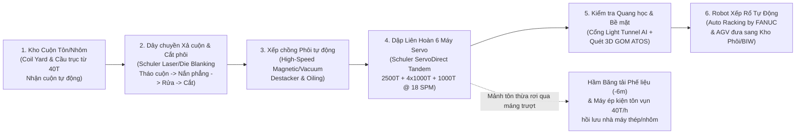
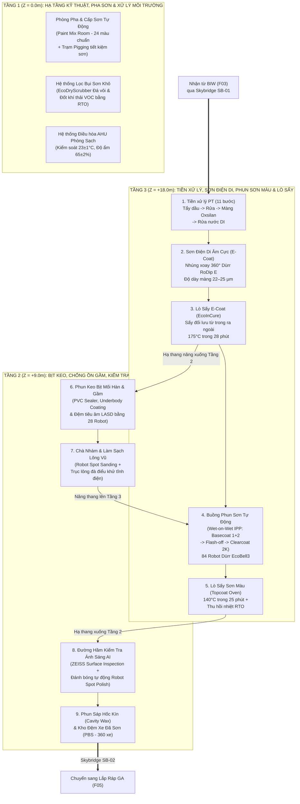
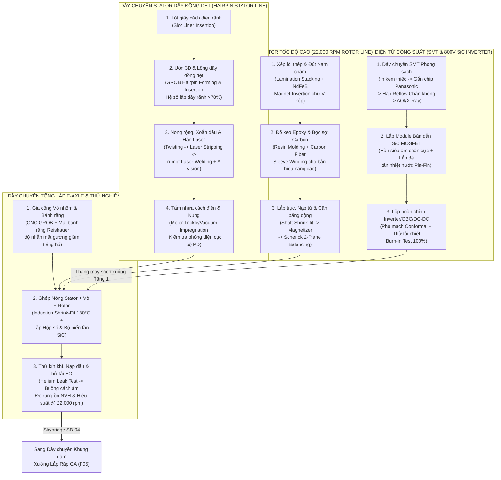
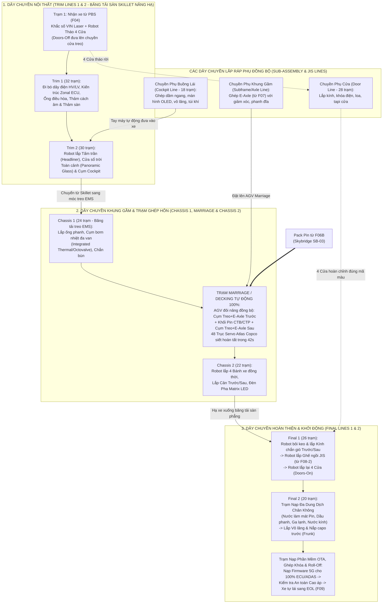
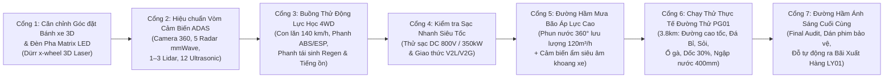
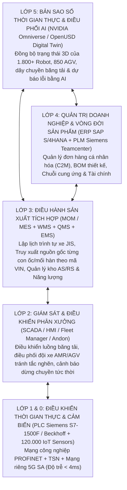

# BẢN THIẾT KẾ TỔNG THỂ & KỸ THUẬT CHI TIẾT TỔ HỢP NHÀ MÁY SẢN XUẤT XE ĐIỆN THẾ HỆ MỚI (KẾ HOẠCH 1: GIGAFACTORY TÍCH HỢP 350 HA)

> [!IMPORTANT]
> **Mục đích tài liệu (AI-Ready Master Blueprint)**: Tài liệu này được thiết kế theo chuẩn **Đa mục đích (Dual-Purpose Engineering & Spatial Specification)** — vừa là hồ sơ thiết kế kỹ thuật công nghệ (EPC, dây chuyền sản xuất, danh mục máy móc BOM, hạ tầng tiện ích, vận hành MES/SCADA), vừa cung cấp **hệ tọa độ không gian 3D chuẩn hóa, kích thước hình học, luồng vật liệu và thông số động học** để các AI tiếp theo (AI dựng mô hình 3D `viz3d`/Three.js/Blender, AI mô phỏng Digital Twin `OpenUSD`/`Isaac Sim`/`SimReady`, AI quản lý dự án & tự động hóa) có thể đọc hiểu và xây dựng hoàn chỉnh một tổ hợp nhà máy xe điện thực tế mà không cần suy đoán thông số.

---

## PHẦN I: PHÂN TÍCH ĐỐI SÁNH & TRIẾT LÝ CÔNG NGHỆ TỔ HỢP (BENCHMARK SYNTHESIS)

### 1.1. Tổng hợp tinh hoa từ 3 hệ sinh thái sản xuất xe điện hàng đầu thế giới

Bản thiết kế này kết hợp có chọn lọc những ưu thế vượt trội nhất từ ba mô hình nhà máy xe điện tiên tiến hiện nay:

| Tiêu chí công nghệ | Mô hình Tesla (Shanghai GF3, Berlin GF4, Texas GF5) | Mô hình Trung Quốc (Xiaomi EV Bắc Kinh, BYD Zhengzhou, Zeekr 5G) | Mô hình VinFast Toàn cầu (Hải Phòng 335ha, Bắc Carolina, Ấn Độ) | **Giải pháp áp dụng cho Tổ hợp Thiết kế (Hybrid Giga-Smart 4.0)** |
|---|---|---|---|---|
| **Quy hoạch mặt bằng (Master Layout)** | Hợp khối khổng lồ (*Spine / Diamond layout*), giảm tối đa khoảng cách vận chuyển giữa các xưởng. | Tích hợp dọc toàn phần (*Mega Vertical Integration*) + nhà máy không đèn (*Dark Factory*) phủ sóng 5G. | Phân khu chức năng rõ ràng + Khu công nghiệp phụ trợ nội khu (*Supplier Park*) + Cầu nối liên hoàn. | **Trục Xương Sống Trung Tâm (Central Spine)** kết nối bằng hệ thống cầu băng tải kín **Skybridge 2 tầng** + Khu Phụ trợ sát vách chuyền lắp ráp. |
| **Tạo hình Khung gầm & Thân vỏ** | **Giga-casting** (IDRA 6.000T–9.000T) đúc nguyên khối sàn trước/sau, giảm ~140 chi tiết dập hàn. | **Hyper-casting 9.100T** (Xiaomi/LK) tích hợp đảo đúc 9 bước + kiểm tra X-Ray AI 100% trong 2 giây. | Dập liên hoàn **Schuler Servo-Direct** tốc độ cao + Hàn BIW 1.200 robot ABB linh hoạt đa mẫu xe. | **Song hành**: Xưởng Đúc áp lực **9.100T** (cho sàn trước/sau) + Xưởng Dập **Schuler Servo** (cho vỏ ngoài & sàn giữa) + Xưởng Hàn BIW **100% tự động (Dark Factory)**. |
| **Công nghệ Pin & Khung gầm** | **Cell 4680 + Structural Pack (CTC)** (Pin là sàn xe, gắn trực tiếp ghế lên nắp pin). | **Blade Battery LFP / Qilin NMC + CTB (Cell-to-Body)** tích hợp nắp pin làm sàn thân vỏ. | Nhập/tự sản xuất Cell + Đóng gói Pack Pin tự động cao, chống nước/bụi IP67/IP69K. | Nhà máy sản xuất **Cell Pin tại chỗ** (Phòng khô điểm sương `-45°C`) + Xưởng **Pack Pin CTB/CTP** chuyển thẳng qua hầm/cầu sang trạm ghép gầm. |
| **Công nghệ Sơn (Paint Shop)** | Hệ thống sơn tinh gọn, sấy tiết kiệm năng lượng, giảm diện tích bể nhúng. | Tự động hóa 100% phun keo, phun sơn tĩnh điện, kiểm tra lỗi bề mặt bằng thị giác máy. | Công nghệ **Dürr RoDip E** (nhúng xoay 360°), **EcoDryScrubber** (lọc sơn khô không nước), **EcoBell3**. | Xưởng Sơn 3 tầng chuẩn **Dürr Eco+**: nhúng xoay **RoDip E**, sấy từ trong ra ngoài **EcoInCure**, lọc khô **EcoDryScrubber**, quy trình **Wet-on-Wet Primerless**. |
| **Lắp ráp Tổng thành (General Assembly)** | Mặt bằng xương cá cho xe tải cập thẳng vào vị trí lắp; hướng tới *Unboxed Process* (lắp cụm song song). | Hàng trăm **AMR/AGV** cấp liệu theo bộ (*SPS*) và đúng thứ tự (*JIS*); nạp phần mềm OTA tự động. | Dây chuyền **Eisenmann** linh hoạt, trạm **Marriage** ghép đồng thời Pin + E-Axle + Thân xe tự động. | Mặt bằng **chữ E (Dock-to-Line)** + Lắp ráp mô-đun song song (Cockpit, Cửa, Ghế JIS, Sàn Pin) + Trạm **Marriage 48 trục Servo** + Xe tự hành lăn bánh cuối chuyền. |

---

### 1.2. Các chỉ số thiết kế cốt lõi của Tổ hợp (Master Design KPIs)

* **Tên dự án**: Tổ hợp Công nghiệp Sản xuất Ô tô Điện Thông minh (**EV Gigafactory Complex - Phase 1**)
* **Tổng diện tích đất quy hoạch**: **350,0 ha** (`3.500.000 m²`) — kích thước mặt bằng chữ nhật chuẩn hóa: **Chiều ngang Đông-Tây `X = 2.500 m` × Chiều dọc Bắc-Nam `Y = 1.400 m`**.
* **Mật độ xây dựng**:
  * Diện tích xây dựng nhà xưởng có mái che (Footprint): **1.185.000 m²** (~33,8% diện tích đất).
  * Tổng diện tích sàn xây dựng (GFA - tính cả nhà xưởng nhiều tầng): **1.540.000 m²**.
  * Diện tích đường thử, bãi xe thành phẩm & giao thông nội khu: **1.415.000 m²** (~40,4%).
  * Diện tích cây xanh, hồ điều hòa sinh thái & hành lang cách ly: **900.000 m²** (~25,8%).
* **Công suất thiết kế**:
  * **Giai đoạn 1A (Tiêu chuẩn)**: **300.000 xe/năm** — Tốc độ dây chuyền **60 JPH** (*Jobs Per Hour*), **Takt Time = 60 giây/xe**.
  * **Giai đoạn 1B (Nâng công suất cực đại)**: **500.000 xe/năm** — Tốc độ dây chuyền **90 JPH**, **Takt Time = 40 giây/xe**.
  * **Chế độ vận hành**: 3 ca/ngày × 7,5 giờ thực chạy/ca = **22,5 giờ/ngày**, **300 ngày/năm** (1,5 giờ/ngày dành cho bảo trì dự đoán PM).
* **Danh mục sản phẩm lắp ráp hỗn hợp (Mixed-Model Production trên 2 nền tảng khung gầm E-Platform)**:
  1. **Model A (`EV-B/C SUV`)**: Crossover/SUV đô thị cỡ B/C (dài `4.300–4.600 mm`, Pin LFP CTB `60–75 kWh`, 1 mô-tơ cầu sau `160 kW`).
  2. **Model B (`EV-D Sedan`)**: Coupe Sedan thể thao cỡ D (dài `4.950 mm`, kiến trúc điện `800V SiC`, Pin NMC CTB `85–101 kWh`, 2 mô-tơ AWD `495 kW`).
  3. **Model C (`EV-D/E SUV`)**: SUV 6–7 chỗ cao cấp (dài `5.100 mm`, kiến trúc `800V`, Pin NMC `105–120 kWh`, 2 mô-tơ AWD + hệ thống treo khí nén).
  4. **Model D (`EV-MPV`)**: MPV điện thông minh 7 chỗ (dài `5.200 mm`, sàn phẳng hoàn toàn, cửa lùa điện đôi).

---

## PHẦN II: QUY HOẠCH TỔNG MẶT BẰNG & TỌA ĐỘ KHÔNG GIAN 3D (MASTER SITE LAYOUT)

### 2.1. Hệ quy chiếu Không gian 3D dành cho AI Dựng hình & Mô phỏng

Để các AI 3D (`viz3d`, `OpenUSD`, `Isaac Sim`, `BIM/CAD`) dựng chính xác toàn bộ tổ hợp mà không bị chồng lấn:
* **Gốc tọa độ `(0, 0, 0)`**: Đặt tại **Góc Tây-Nam (Southwest Corner)** của khu đất 350 ha, cao độ mặt đất chuẩn `Z = 0.00 m`.
* **Trục `X` (Đông - Tây)**: Từ `X = 0 m` (biên phía Tây - Cổng Logistics Nguyên vật liệu) đến `X = 2.500 m` (biên phía Đông - Bãi xuất xe thành phẩm & Đường thử).
* **Trục `Y` (Nam - Bắc)**: Từ `Y = 0 m` (biên phía Nam - Đại lộ chính, Trung tâm R&D & Điều hành) đến `Y = 1.400 m` (biên phía Bắc - Khu Năng lượng, Môi trường & Nhà máy Cell Pin).
* **Trục `Z` (Cao độ)**: `Z > 0` hướng thẳng đứng lên trời (đơn vị: mét). Các cầu băng tải liên xưởng (**Skybridge**) chạy ở cao độ thông thủy `Z = +8,5 m` đến `Z = +14,0 m` để xe đầu kéo container (`cao 4,5 m`) lưu thông tự do bên dưới.

### 2.2. Sơ đồ Quy hoạch Phân khu Tổng thể (Master Site Topology)

```mermaid
flowchart TB
    subgraph NORTH["PHÍA BẮC (Y: 980m -> 1400m): CỤM NĂNG LƯỢNG, PIN & ĐỘNG CƠ"]
        direction LR
        UT01["UT01: Trạm Biến Áp 220kV\n& BESS 100MWh\n(X:80..320, Y:1050..1320)"]
        UT02["UT02-04: Trung tâm Tiện ích CUB,\nKhí công nghiệp & Xử lý nước ZLD\n(X:360..780, Y:1050..1320)"]
        F06A["F06A: Nhà máy Cell Pin 40GWh\n(Phòng khô -45°C)\n(X:840..1540, Y:1020..1340)"]
        F06B["F06B: Xưởng Đóng gói Pack Pin\n(CTP / CTB Structural)\n(X:1580..1980, Y:1020..1340)"]
        F07["F07: Xưởng Động cơ E-Axle\n& Điện tử công suất SiC\n(X:2020..2420, Y:1020..1340)"]
    end

    subgraph CENTER["TRỤC XƯƠNG SỐNG TRUNG TÂM (Y: 460m -> 940m): DÂY CHUYỀN SẢN XUẤT CHÍNH"]
        direction LR
        F01["F01: Xưởng Đúc Giga-Casting\n(6 Đảo đúc 9.100T)\n(X:80..380, Y:680..920)"]
        F02["F02: Xưởng Dập Liên Hoàn\n(Schuler Servo Press)\n(X:80..380, Y:460..660)"]
        F03["F03: Xưởng Hàn Thân Vỏ BIW\n(1.250 Robot - Dark Factory)\n(X:430..980, Y:460..920)"]
        F04["F04: Xưởng Sơn Sinh Thái 3 Tầng\n(Dürr RoDip E & EcoBell3)\n(X:1040..1440, Y:520..880)"]
        F05["F05: Xưởng Lắp Ráp Tổng Thành GA\n(Thiết kế Chữ E - Dock-to-Line)\n(X:1500..2150, Y:460..920)"]
        F09["F09: Trung tâm Kiểm định EOL\n& Hiệu chuẩn ADAS\n(X:2200..2420, Y:520..880)"]
    end

    subgraph SOUTH["PHÍA NAM (Y: 0m -> 420m): PHỤ TRỢ NỘI KHU, KHO AS/RS, R&D & ĐƯỜNG THỬ"]
        direction LR
        WH01["WH01: Kho Tự Động AS/RS\n& Trung tâm Điều phối AGV\n(X:80..380, Y:80..400)"]
        F08["F08 (1..5): Khu Công Nghiệp Phụ Trợ\n(Nhựa, Ghế JIS, Dập nóng, Kính, Dây điện)\n(X:430..1250, Y:80..400)"]
        IOC01["IOC01 & RD01: Trung tâm Điều hành AI,\nR&D, Lab Pin & Thử Va Chạm\n(X:1300..1780, Y:80..380)"]
        PG01["PG01 & LY01: Đường Thử 16 Địa Hình (3.8km)\n& Bãi Xuất Xe Thành Phẩm\n(X:1820..2450, Y:60..420)"]
    end

    F01 -->|Phôi đúc sàn trước/sau| F03
    F02 -->|Phôi dập vỏ & khung| F03
    F08 -->|Thép dập nóng 2000MPa| F03
    F03 ==>|Skybridge SB-01 (Thân vỏ trắng BIW)| F04
    F04 ==>|Skybridge SB-02 (Thân vỏ đã sơn)| F05
    F06A -->|Cell LFP/NMC| F06B
    F06B ==>|Skybridge SB-03 (Pack Pin CTB)| F05
    F07 ==>|Skybridge SB-04 (Cụm E-Axle Trước/Sau)| F05
    F08 ==>|Skybridge SB-05 (Ghế JIS, Cản, Cockpit)| F05
    WH01 -->|Đội xe 850 AMR/AGV| F05
    F05 ==>|Xe tự hành lăn bánh| F09
    F09 ==>|Kiểm tra động lực & Bàn giao| PG01
```

### 2.3. Bảng Ma trận Tọa độ Không gian 3D của Toàn bộ 24 Hạng mục Công trình

Bảng dưới đây quy định tọa độ góc Tây-Nam `(X_min, Y_min)`, kích thước `(Width_X, Length_Y, Height_Z)`, số tầng, bước cột kết cấu và tải trọng sàn của từng tòa nhà:

| Mã hạng mục | Tên Nhà máy / Công trình | `X_min` (m) | `Y_min` (m) | Rộng `X` (m) | Dài `Y` (m) | Cao `Z` (m) | Số tầng | Diện tích sàn GFA (m²) | Bước cột chuẩn (m × m) | Tải trọng sàn tầng 1 (tấn/m²) |
|---|---|---|---|---|---|---|---|---|---|---|
| **`F01`** | **Xưởng Đúc Áp Lực Siêu Lớn (Giga-Casting Shop)** | 80 | 680 | 300 | 240 | 22,0 | 1 | 72.000 | 24 × 30 | 25,0 (Móng cọc máy đúc 60,0) |
| **`F02`** | **Xưởng Dập Liên Hoàn (Servo Stamping Shop)** | 80 | 460 | 300 | 200 | 24,0 | 1 (+Hầm phế liệu `-6m`) | 60.000 | 24 × 30 | 30,0 (Hố móng máy dập 50,0) |
| **`F03`** | **Xưởng Hàn Thân Vỏ Tự Động (BIW Dark Factory)** | 430 | 460 | 550 | 460 | 16,0 | 1 (+Tầng lửng điện/hàn `+7m`) | 290.000 | 24 × 24 | 10,0 |
| **`F04`** | **Xưởng Sơn Sinh Thái Thông Minh (Eco Paint Shop)** | 1040 | 520 | 400 | 360 | 28,5 | 3 tầng (`0m`, `+9m`, `+18m`) | 432.000 | 18 × 24 | 8,0 (Tầng 2, 3: 3,5) |
| **`F05`** | **Xưởng Lắp Ráp Tổng Thành (General Assembly - Chữ E)** | 1500 | 460 | 650 | 460 | 16,5 | 1 (+Tầng lửng băng tải EMS `+6.5m`) | 345.000 | 24 × 24 | 8,0 |
| **`F06A`** | **Nhà Máy Sản Xuất Cell Pin (Battery Cell Gigafactory)** | 840 | 1020 | 700 | 320 | 18,0 | 2 tầng | 350.000 | 18 × 24 | 12,0 (Phòng khô điểm sương `-45°C`) |
| **`F06B`** | **Xưởng Đóng Gói Pack Pin (CTP / CTB Pack Shop)** | 1580 | 1020 | 400 | 320 | 15,0 | 1 | 128.000 | 24 × 24 | 10,0 |
| **`F07`** | **Xưởng Chế Tạo Động Cơ Điện & Điện Tử Công Suất (E-Axle)** | 2020 | 1020 | 400 | 320 | 15,0 | 2 (Tầng 2: Phòng sạch SMT) | 180.000 | 18 × 24 | 10,0 (Tầng 2: 2,5) |
| **`F08-1`** | **Xưởng Phụ trợ 1: Ép Phun Nhựa & Sơn Cản (Plastic/Bumper)** | 430 | 250 | 260 | 150 | 16,0 | 1 | 39.000 | 24 × 24 | 15,0 |
| **`F08-2`** | **Xưởng Phụ trợ 2: Sản Xuất Ghế Ngồi JIS (Seat Factory)** | 710 | 250 | 260 | 150 | 14,0 | 1 | 39.000 | 18 × 24 | 5,0 |
| **`F08-3`** | **Xưởng Phụ trợ 3: Dập Nóng Thép Siêu Cường (Hot Stamping)** | 430 | 80 | 260 | 150 | 16,0 | 1 | 39.000 | 24 × 24 | 20,0 |
| **`F08-4`** | **Xưởng Phụ trợ 4: Mô-đun Kính, Cửa & Buồng Lái (Cockpit/Glass)** | 710 | 80 | 260 | 150 | 14,0 | 1 | 39.000 | 18 × 24 | 5,0 |
| **`F08-5`** | **Xưởng Phụ trợ 5: Bó Dây Điện HV/LV & Ống Dẫn (Wiring Harness)** | 990 | 80 | 260 | 320 | 14,0 | 2 | 120.000 | 18 × 18 | 5,0 |
| **`F09`** | **Trung Tâm Kiểm Định Cuối Chuyền (EOL & ADAS Calibration)** | 2200 | 520 | 220 | 360 | 12,0 | 1 | 79.200 | 24 × 24 | 6,0 |
| **`WH01`** | **Kho Tự Động Cao Tầng AS/RS & Hub Logistics Nội Khu** | 80 | 80 | 300 | 320 | 32,0 | Kệ 14 tầng | 96.000 | Kệ Rack chịu lực | 18,0 |
| **`IOC01`** | **Tòa Nhà Điều Hành Trung Tâm, AI Data Center & Văn Phòng** | 1300 | 80 | 180 | 140 | 36,0 | 8 tầng | 85.000 | 9 × 12 | 1,5 (Phòng Server: 3,0) |
| **`RD01`** | **Viện Nghiên Cứu R&D, Lab Pin, Hầm Gió & Nhà Thử Va Chạm** | 1500 | 80 | 280 | 300 | 18,0 | 2 tầng | 110.000 | 18 × 30 | 12,0 (Đường kéo Crash Test: 200m) |
| **`PG01`** | **Đường Thử Xe Đa Địa Hình (16-Surface Proving Ground)** | 1820 | 60 | 630 | 220 | 0,0 | Ngoài trời | 138.600 | Mặt đường đặc chủng | Tải trục 15 tấn |
| **`LY01`** | **Bãi Lưu Kho Xe Thành Phẩm, Trạm Sạc Siêu Tốc & Cổng Xuất** | 1820 | 300 | 630 | 120 | 6,0 | Mái che Pin mặt trời | 75.600 | Khung mái Solar | 5,0 |
| **`UT01`** | **Trạm Biến Áp 220kV/110kV (350 MVA) & Pin Lưu Trữ BESS (100 MWh)** | 80 | 1050 | 240 | 270 | 12,0 | 1 | 64.800 | Trạm ngoài trời + Nhà GIS | 10,0 |
| **`UT02`** | **Trung Tâm Năng Lượng Tiện Ích (CUB: Chiller, Khí nén, Bơm nhiệt)** | 360 | 1050 | 160 | 270 | 14,0 | 2 | 43.200 | 12 × 18 | 12,0 |
| **`UT03`** | **Trạm Sản Xuất & Lưu Trữ Khí Công Nghiệp (N2, Ar, CO2, He)** | 540 | 1050 | 100 | 270 | 15,0 | 1 | 27.000 | Bồn Cryo đứng | 15,0 |
| **`UT04`** | **Nhà Máy Xử Lý Nước Cấp DI & Nước Thải Tuần Hoàn ZLD** | 660 | 1050 | 120 | 270 | 10,0 | 1 (+Bể ngầm `-5m`) | 32.400 | Hệ bể bê tông | 15,0 |
| **`UT05`** | **Trạm Cứu Hỏa Chuyên Dụng Xe Điện, Y Tế & Căng Tin Trung Tâm** | 1300 | 250 | 180 | 130 | 12,0 | 3 tầng | 45.000 | 12 × 12 | 2,5 |

---

## PHẦN III: THIẾT KẾ CHI TIẾT TỪNG NHÀ MÁY, CÔNG ĐOẠN & DANH MỤC MÁY MÓC (SHOP-BY-SHOP BLUEPRINT)

---

### 3.1. NHÀ MÁY 01 (`F01`): XƯỞNG ĐÚC ÁP LỰC SIÊU LỚN (GIGA-CASTING / HYPER-CASTING SHOP)

#### A. Nhiệm vụ & Công nghệ cốt lõi
Thay vì dập và hàn 72–140 chi tiết thép nhỏ lẻ cho phần khung gầm phía sau (*Rear Underbody*) và khung gầm phía trước (*Front Shock Tower & Subframe*), xưởng `F01` sử dụng **6 Đảo Đúc Áp Lực Buồng Lạnh Chân Không Siêu Lớn lực khóa khuôn 9.100 tấn** (tương tự *Xiaomi HyperCasting 9100T* và *Tesla IDRA Giga Press 9000T*). Hợp kim nhôm đặc chủng (`AlSi7MgTi` / `Tesla-Xiaomi Alloy`) không cần qua lò nhiệt luyện và làm nguội cưỡng bức sau đúc, giúp loại bỏ hoàn toàn hiện tượng cong vênh kích thước.

#### B. Sơ đồ Quy trình Công nghệ 9 Bước Khép Kín (Giga-Casting Island Flow)

```mermaid
flowchart LR
    S1["1. Nấu chảy & Tinh luyện\n(Lò StrikoWestofen 8T/h\n+ Khử khí Ar quay)"] --> S2["2. Định lượng Nhôm lỏng\n(Bơm điện từ kín\n80–130 kg/nhịp)"]
    S2 --> S3["3. Đúc Áp Lực 9.100T\n(IDRA/LK DCC9100\nChân không <50 mbar, 0.08s)"]
    S3 --> S4["4. Làm mát & Gắp phôi\n(Robot KUKA KR1000 Titan\nNhúng/Phun sương làm nguội)"]
    S4 --> S5["5. Cắt Đậu ngót & Ba-via\n(Máy dập Trim Press 250T\n+ Robot cắt Plasma/Laser)"]
    S5 --> S6["6. Kiểm tra X-Ray AI 100%\n(Buồng X-Ray Yxlon/ZEISS\nPhát hiện rỗ khí trong 2s)"]
    S6 --> S7["7. Gia công Phay/Khoan 5 Trục\n(Trung tâm CNC đôi GROB G920F\nĐộ chính xác ±0.02mm)"]
    S7 --> S8["8. Tẩy rửa & Quét Laser 3D\n(Rửa siêu âm + GOM ATOS\nĐo 120 điểm lắp ghép)"]
    S8 --> S9["9. Khắc Mã QR Laser\n& Chuyển sang BIW (F03)\nqua băng tải AGV nặng"]
    S5 -.->|Đậu ngót & Phế phẩm nhôm (35%)| S1
```

#### C. Phân vùng mặt bằng bên trong Xưởng `F01` (`300 m × 240 m = 72.000 m²`)
* **Zone F01-Z1 (Phía Tây, `x_local: 0..60m, y_local: 0..240m`)**: Kho thỏi nhôm nguyên liệu, khu băm nghiền đậu ngót hồi lưu và **6 Tháp lò nấu chảy/giữ nhiệt trung tâm** (`720°C`).
* **Zone F01-Z2 (Trung tâm Tây, `x_local: 60..160m, y_local: 0..240m`)**: **6 Đảo đúc áp lực 9.100T** bố trí song song (3 đảo đúc Sàn sau *Rear Mega-casting*, 3 đảo đúc Sàn trước *Front Mega-casting*). Mỗi đảo có kích thước `28 m × 32 m`, trang bị cầu trục đôi `125 tấn` để thay bộ khuôn nặng `95–110 tấn`.
* **Zone F01-Z3 (Trung tâm Đông, `x_local: 160..240m, y_local: 0..240m`)**: **24 Trung tâm gia công CNC 5 trục cổng đôi** (4 máy CNC đi kèm mỗi đảo đúc để cân bằng nhịp 80–90 giây/phôi).
* **Zone F01-Z4 (Phía Đông, `x_local: 240..300m, y_local: 0..240m`)**: Khu bảo dưỡng khuôn đúc (Die Maintenance), buồng kiểm tra X-Ray/CT-Scan, trạm đo 3D CMM và hành lang AGV nối thẳng sang Xưởng Hàn `F03`.

#### D. Danh mục Máy móc Thiết bị Chính Xưởng `F01` (Equipment BOM)

| Mã TB | Tên Máy móc / Thiết bị | Hãng / Model tham chiếu | Thông số kỹ thuật chính | Số lượng | Công suất điện (kW/đơn vị) | Chu kỳ (Cycle Time) |
|---|---|---|---|---|---|---|
| `F01-EQ01` | Máy đúc áp lực buồng lạnh siêu lớn | IDRA OL 9000 CS / LK Impress-Plus DCC9100 | Lực khóa khuôn `91.000 kN` (9.100 tấn), hành trình mở khuôn `2.100 mm`, tốc độ bắn nhôm `10 m/s` | 6 tổ hợp | 650 kW | 80 – 90 giây/phôi |
| `F01-EQ02` | Lò nấu chảy và giữ nhiệt nhôm liên hoàn | StrikoWestofen StrikoMelter | Công suất nấu `8,0 tấn/giờ`, hiệu suất nhiệt >80%, tích hợp khử khí Argon | 6 hệ thống | 420 kW (+Khí đốt/Điện) | Liên tục |
| `F01-EQ03` | Hệ thống hút chân không khuôn đúc cao áp | Fondarex High-Vac Ultra | Áp suất chân không lòng khuôn `< 30 mbar` trong `0,05 giây` | 6 hệ thống | 45 kW | Theo nhịp đúc |
| `F01-EQ04` | Robot phun chất thoát khuôn & Gắp phôi | KUKA KR 1000 Titan + ABB IRB 7600 | Tải trọng tay máy `1.000 kg`, tầm với `3.200 mm`, chịu nhiệt cao | 18 robot (3/đảo) | 22 kW | 80 giây |
| `F01-EQ05` | Máy dập cắt đậu ngót & Ba-via tự động | Reis / Schuler Trim Press 250T | Lực cắt `250 tấn`, bàn trượt thủy lực + Robot cắt tia Plasma/Laser | 6 máy | 90 kW | 40 giây |
| `F01-EQ06` | Buồng kiểm tra X-Ray AI trực tuyến | Yxlon Cheetah / ZEISS VoluMax AI | Chụp 28 góc X-Ray tự động, thuật toán AI phân loại lỗ rỗ khí trong `2,0 giây` | 6 buồng | 35 kW | 35 giây |
| `F01-EQ07` | Trung tâm gia công CNC 5 trục hành trình lớn | GROB G920F / Modig HHV | Gia công đồng thời 2 đầu trục chính `24.000 rpm`, phay mặt lắp ghép & khoan lỗ SPR | 24 máy | 110 kW | 160 giây/máy (4 máy/đảo) |
| `F01-EQ08` | Cầu trục đôi hạng nặng phục vụ thay khuôn | Konecranes / Demag 125/32T | Sức nâng chính `125 tấn`, phụ `32 tấn`, khẩu độ `30 m`, điều khiển chống lắc | 4 chiếc | 140 kW | Theo lịch thay khuôn |

---

### 3.2. NHÀ MÁY 02 (`F02`): XƯỞNG DẬP LIÊN HOÀN TỐC ĐỘ CAO (SERVO STAMPING SHOP)

#### A. Nhiệm vụ & Công nghệ cốt lõi
Sản xuất toàn bộ các tấm vỏ ngoại thất yêu cầu chất lượng bề mặt **Class-A** (Nắp capo, 2 vách hông ngoài Body Side Outer, 4 cánh cửa, Nắp cốp, Mui xe) và các chi tiết kết cấu thép/nhôm trung tâm theo mô hình của **VinFast Hải Phòng (dây chuyền Schuler Đức)** và **Tesla**. Toàn bộ xưởng vận hành khép kín, có tầng hầm thu gom phế liệu tự động ở cao độ `Z = -6,0 m`.

#### B. Sơ đồ Quy trình Công nghệ Xưởng Dập (`F02`)



#### C. Phân vùng mặt bằng bên trong Xưởng `F02` (`300 m × 200 m = 60.000 m²`)
* **Zone F02-Z1 (`x_local: 0..50m`)**: Kho cuộn tôn/nhôm tự động (*Automated Coil Storage*, sức chứa 450 cuộn nặng 25–35 tấn/cuộn) + **2 Dây chuyền Cắt phôi (1 Die Blanking Line + 1 Laser Blanking Line không dùng khuôn)**.
* **Zone F02-Z2 (`x_local: 50..130m`)**: Khu lưu trữ khuôn dập trung tâm (*Die Storage Bay*, sức chứa 180 bộ khuôn) và bàn trượt thay khuôn tự động hai phía (*Moving Bolster*).
* **Zone F02-Z3 (`x_local: 130..230m`)**: **4 Dây chuyền Dập Liên Hoàn Schuler ServoDirect**:
  * **Line P1 & P2 (Dây chuyền Hạng nặng XL)**: 6 máy dập (`1×2.500T + 4×1.200T + 1×1.000T`, tổng lực `8.300 tấn/chuyền`), chuyên dập vách hông nguyên tấm (*Body Side Outer*), nắp capo, sàn giữa, tốc độ `15–18 nhịp/phút (SPM)`.
  * **Line P3 & P4 (Dây chuyền Tốc độ cao M/L)**: 5 máy dập (`1×2.000T + 4×1.000T`, tổng lực `6.000 tấn/chuyền`) + **1 Máy dập truyền nguyên khối (Transfer Press 3.200T)**, tốc độ `20–32 SPM`, chuyên dập cửa, tai xe, dầm ngang.
* **Zone F02-Z4 (`x_local: 230..300m`)**: Khu đóng rổ tự động bằng robot và Kho đệm phôi dập (*Stamped Part Buffer Warehouse*) cao 14 m nối trực tiếp sang Xưởng Hàn `F03`.

#### D. Danh mục Máy móc Thiết bị Chính Xưởng `F02` (Equipment BOM)

| Mã TB | Tên Máy móc / Thiết bị | Hãng / Model tham chiếu | Thông số kỹ thuật chính | Số lượng | Công suất điện (kW/đơn vị) | Chu kỳ (Cycle Time) |
|---|---|---|---|---|---|---|
| `F02-EQ01` | Dây chuyền xả cuộn & Cắt phôi bằng khuôn | Schuler / Fagor Arrasate | Khổ tôn `400–2.150 mm`, dày `0,6–3,0 mm`, tốc độ `75 nhịp/phút`, áp lực cắt `800T` | 1 dây chuyền | 550 kW | 0,8 giây/phôi |
| `F02-EQ02` | Dây chuyền cắt phôi Laser đa tia (Coil-Fed) | Schuler Dynamic / Trumpf 3D Laser | 3 đầu cắt Laser sợi quang `6 kW`, cắt biên dạng bất kỳ cho cả nhôm và thép không cần khuôn cắt | 1 dây chuyền | 480 kW | 2,5 giây/phôi |
| `F02-EQ03` | Dây chuyền Dập liên hoàn Servo XL (6 máy) | Schuler ServoDirect Tandem XL | `1×2.500T + 4×1.200T + 1×1.000T`, tay gắp Crossbar Feeder, thay khuôn tự động ADC trong `180 giây` | 2 dây chuyền | 2.200 kW | 3,3 – 4,0 giây/chi tiết |
| `F02-EQ04` | Dây chuyền Dập liên hoàn Servo L (5 máy) | Schuler ServoDirect Tandem L | `1×2.000T + 4×1.000T`, buồn kín cách âm `< 78 dB` | 2 dây chuyền | 1.650 kW | 3,0 giây/chi tiết |
| `F02-EQ05` | Máy dập liên hoàn Transfer Press | Komatsu / Schuler 3200T Transfer | Lực dập `3.200 tấn`, thanh truyền 3D Servo, dập đồng thời 2 chi tiết đối xứng (Trái/Phải) | 1 dây chuyền | 1.400 kW | 2,0 giây/cặp |
| `F02-EQ06` | Hệ thống băng tải & Máy ép kiện tôn vụn ngầm | Mayfran + Lindemann Scrap Baler | Đặt tại tầng hầm `Z = -6m`, thu gom 100% phế liệu thép và nhôm tách riêng, ép cục `60×60 cm` | 2 hệ thống | 380 kW | 40 tấn/giờ |
| `F02-EQ07` | Buồng đo quang học ánh sáng xanh 3D | ZEISS GOM ATOS ScanBox 6130 | Robot tự động quét 3D toàn bộ tấm vỏ dập so với file CAD gốc, độ chính xác `±0,015 mm` | 4 buồng | 18 kW | 180 giây/mẫu |

---

### 3.3. NHÀ MÁY 03 (`F03`): XƯỞNG HÀN THÂN VỎ TỰ ĐỘNG 100% (BIW - BODY-IN-WHITE "DARK FACTORY")

#### A. Nhiệm vụ & Công nghệ cốt lõi
Lắp ghép các khối đúc nhôm từ `F01`, các tấm vỏ thép/nhôm dập từ `F02`, và các chi tiết thép dập nóng cường độ siêu cao (`1.500–2.000 MPa`) từ `F08-3` thành khung thân vỏ hoàn chỉnh (**Body-in-White - BIW**).
Vì thân vỏ xe điện thế hệ mới có cấu trúc **vật liệu lai (Multi-Material Body: Nhôm đúc + Thép Boron dập nóng + Thép AHSS + Nhôm tấm)**, xưởng `F03` không chỉ dùng Hàn điểm kháng trở (*Spot Welding*) như xe truyền thống mà tích hợp **7 công nghệ liên kết tiên tiến** với **1.250 Robot công nghiệp hoạt động tự động hóa 100% (không có công nhân đứng trong ô hàn)**:
1. **Hàn điểm thích ứng (Adaptive Resistance Spot Welding - Bosch Rexroth)** cho kết cấu thép-thép.
2. **Tán đinh tự đột (SPR - Self-Piercing Riveting - Henrob/Atlas Copco)** để ghép khối nhôm đúc Giga-casting với dầm thép/nhôm.
3. **Bắn vít dòng chảy tốc độ cao (FDS - Flow Drill Screwing - Weber)** cho các vị trí hộp kín chỉ tiếp cận được từ 1 phía.
4. **Dán keo kết cấu cường độ cao (Structural Crash Adhesive - Sika/Henkel + Vision kiểm tra đường keo 3D)** tăng độ cứng xoắn khung xe lên `> 45.000 Nm/deg`.
5. **Hàn vảy Laser (Laser Brazing - Trumpf)** nối tấm mui xe với vách hông tạo rãnh mui liền mạch không cần nẹp nhựa.
6. **Hàn hồ quang CMT (Cold Metal Transfer - Fronius)** ít sinh nhiệt cho khung phụ nhôm.
7. **Gấp mép con lăn bằng Robot (Robot Roller Hemming)** cho 4 cửa, capo và cốp sau.

#### B. Sơ đồ Luồng Công nghệ 8 Phân Khu Xưởng Hàn BIW (`F03`)

```mermaid
flowchart TB
    subgraph UB["PHÂN KHU 1-3: TỔ HỢP SÀN XE (UNDERBODY LINES)"]
        UF["PK1: Sàn Trước (Front Underbody)\nKhối đúc F01 + Dầm hấp thụ xung lực\n(SPR + FDS + Keo kết cấu)"]
        UC["PK2: Sàn Giữa (Center Floor / CTB Frame)\nKhung dầm dọc + Sàn khoang lắp Pin CTB\n(Spot Weld + Stud Weld)"]
        UR["PK3: Sàn Sau (Rear Underbody)\nKhối đúc 9100T F01 + Hốc đuôi xe\n(SPR + Keo kết cấu)"]
        UM["Trạm Ghép Sàn Chính (Underbody Marriage)\nGhép Trước + Giữa + Sau + Đo hình học 3D"]
        UF --> UM
        UC --> UM
        UR --> UM
    end

    subgraph BS["PHÂN KHU 4: VÁCH HÔNG TRÁI & PHẢI (BODY SIDE LH/RH)"]
        BSI["Hàn Vách Hông Trong (Body Side Inner)\nGhép cột A, B, C thép dập nóng 2000MPa"]
        BSO["Ghép Vách Hông Ngoài (Body Side Outer)\nHàn điểm + Bôi keo chống rung"]
        BSI --> BSO
    end

    subgraph MAIN["PHÂN KHU 5-6: ĐỊNH HÌNH TỔNG THÀNH & HÀN MUI (FRAMING & ROOF)"]
        FG["PK5: Cổng Định Hình Tổng Thành (Multi-Model OpenGate)\nGhép Sàn + 2 Vách Hông + Khung Mui\n(20 Robot hàn khóa hình học trong 38 giây)"]
        RS["Dây chuyền Hàn Gia Cường (Respot Line)\n280 Robot hàn hoàn tất >4.200 điểm hàn & 650 đinh SPR"]
        LB["PK6: Trạm Đặt Mui & Hàn Laser (Roof Laser Brazing)\nHàn vảy Laser 2 bên rãnh mui tốc độ 5m/phút"]
        FG --> RS --> LB
    end

    subgraph CL["PHÂN KHU 7-8: LẮP VỎ ĐỘNG, ĐO LƯỜNG 3D & HOÀN THIỆN"]
        CH["PK7: Dây chuyền Cửa, Capo, Cốp (Closures Line)\nGấp mép Roller Hemming + Sấy keo cảm ứng từ"]
        FIT["Trạm Lắp Cửa/Capo/Cốp Tự Động (Auto Hang-On)\nRobot căn chỉnh khe hở mặt phẳng bằng Laser"]
        MET["PK8: Buồng Đo Laser Radar 100% & Hoàn Thiện\n(ZEISS AICell Inline Metrology -> Mài tự động -> Kho WBS)"]
        CH --> FIT --> MET
    end

    UM --> FG
    BSO -->|Cầu tải treo EMS| FG
    LB --> FIT
    MET ==>|Skybridge SB-01 (Cao độ +9.5m)| F04_NEXT["Sang Xưởng Sơn (F04)"]
```

#### C. Phân vùng mặt bằng bên trong Xưởng `F03` (`550 m × 460 m = 253.000 m² mặt đất + 37.000 m² tầng lửng`)
* **Zone F03-Z1 (`x_local: 0..160m, y_local: 0..460m`)**: Phân khu Sàn Trước, Sàn Giữa, Sàn Sau và Ghép Sàn Chính (*Underbody Complex* — 2 dây chuyền song song, mỗi chuyền công suất 45 JPH, tổng 90 JPH).
* **Zone F03-Z2 (`x_local: 160..320m, y_local: 230..460m`)**: Phân khu Vách Hông Trái & Phải (*Body Side Inner & Outer LH/RH*) dùng bàn xoay thay đồ gá tự động (*Turntable Geo-Fixtures*) cho 4 mẫu xe.
* **Zone F03-Z3 (`x_local: 160..320m, y_local: 0..230m`)**: Phân khu Vỏ động (*Closures Sub-assembly*: 4 cửa, nắp capo, cửa hậu, tai xe trước).
* **Zone F03-Z4 (`x_local: 320..470m, y_local: 0..460m`)**: **2 Dây chuyền Định hình Tổng thành & Hàn gia cường (*Main Framing, Respot & Laser Brazing Lines*)** với cổng **Comau OpenGate / KUKA KS Framing** cho phép đổi mẫu xe giữa Sedan và SUV trong **0 giây** (Random Sequence).
* **Zone F03-Z5 (`x_local: 470..550m, y_local: 0..460m`)**: Dây chuyền Lắp vỏ động (*Hang-on Line*), Trạm đo lường Laser 100% trực tuyến, Dây chuyền kiểm tra hoàn thiện bề mặt (*Metal Finish*) và **Kho Đệm Thân Vỏ Trắng (*WBS - White Body Storage*, sức chứa 320 xe)** ở đầu cầu Skybridge `SB-01`.

#### D. Danh mục Máy móc Thiết bị Chính Xưởng `F03` (Equipment BOM)

| Mã TB | Tên Máy móc / Thiết bị | Hãng / Model tham chiếu | Thông số kỹ thuật chính | Số lượng | Công suất điện (kW/đơn vị) | Chu kỳ (Cycle Time) |
|---|---|---|---|---|---|---|
| `F03-EQ01` | Robot hàn điểm, tán đinh & gắp chuyển nặng | ABB IRB 6700 / IRB 7600 & KUKA KR QUANTEC | Tải trọng `150 – 500 kg`, tầm với `2.650 – 3.500 mm`, tích hợp DressPack | 1.250 robot | 12 kW (TB) | 38 – 40 giây/trạm |
| `F03-EQ02` | Súng hàn điểm Servo trung tần thích ứng | Obara / Nimak + Bộ điều khiển Bosch Rexroth WeldTimer | Dòng hàn MFDC `1.000 Hz`, tự động bù hao mòn điện cực và chiều dày tôn | 680 súng | 35 kVA/khi phóng | 1,8 giây/điểm |
| `F03-EQ03` | Hệ thống tán đinh tự đột SPR & Bắn vít FDS | Atlas Copco Henrob / Tucker & Weber FDS | Lực ép đinh `80 kN`, cấp đinh bằng ống khí nén từ tủ cấp phôi trung tâm | 140 bộ | 8 kW | 2,2 giây/đinh |
| `F03-EQ04` | Hệ thống bơm & Phun keo kết cấu thị giác 3D | SCA (Atlas Copco) + Camera Coherix Predator3D | Gia nhiệt keo chính xác, kiểm tra 3D chiều cao/chiều rộng vệt keo ngay khi đang bơm | 165 hệ thống | 6 kW | Liên tục theo quỹ đạo |
| `F03-EQ05` | Cổng định hình hình học đa mẫu xe | Comau OpenGate / KUKA KS Framing | Lưu trữ 6 cặp khung gá bên hông, đổi khung gá giữa SUV/Sedan/MPV trong `12 giây` | 4 cổng chính | 85 kW | 38 giây/xe |
| `F03-EQ06` | Nguồn phát & Đầu quang học Hàn Laser Mui/Cửa | Trumpf TruDisk 6001 + Scansonic ALO4 | Công suất Laser `6 kW`, dẫn tia bằng cáp quang học tự động bám rãnh hàn | 12 trạm | 45 kW | 35 giây/xe |
| `F03-EQ07` | Trạm đo lường hình học thân vỏ 100% Inline | ZEISS AICell Trace / Perceptron AutoGauge | 4 Robot mang cảm biến quang học không tiếp xúc đo 600 điểm tọa độ trên 100% xe | 4 trạm | 15 kW | 38 giây/xe |
| `F03-EQ08` | Hệ thống băng tải sàn Skillet, Roller Bed & EMS | Eisenmann / Dürr / ATS | Gồm 420 bàn trượt Geo-Skillet và 3,2 km đường ray treo điện đơn EMS trên tầng lửng | 1 hệ tổng thể | 950 kW | Đồng bộ Takt 40s |

---

### 3.4. NHÀ MÁY 04 (`F04`): XƯỞNG SƠN SINH THÁI THÔNG MINH 3 TẦNG (ECO-SMART PAINT SHOP)

#### A. Nhiệm vụ & Công nghệ cốt lõi
Nhận thân vỏ trắng (BIW) từ cầu nối `SB-01`, thực hiện xử lý bề mặt chống ăn mòn 12 năm, bịt kín các đường ghép mối hàn, chống ồn gầm và phủ lớp sơn màu hoàn thiện chuẩn thẩm mỹ cao cấp với lượng phát thải VOC và tiêu thụ nước thấp nhất thế giới (theo tiêu chuẩn **Dürr Eco+ Paint Shop** áp dụng tại VinFast, Porsche và Tesla Berlin):
* **Công nghệ nhúng xoay 360° RoDip E**: Thân xe được lật xoay tròn hoàn toàn trong bể tiền xử lý và bể sơn tĩnh điện (ED), giúp chất lỏng len lỏi vào mọi hốc kín của sàn pin, loại bỏ túi khí và rút ngắn chiều dài bể nhúng 6 mét mỗi bể.
* **Màng tiền xử lý Oxsilan (Zirconium Thin-Film)**: Thay thế hoàn toàn công nghệ Phosphat kẽm truyền thống, không phát sinh bùn kim loại nặng và không cần gia nhiệt bể.
* **Lò sấy từ trong ra ngoài EcoInCure**: Thổi khí nóng trực tiếp vào bên trong khoang xe qua lỗ kính chắn gió và đi dọc theo hai dầm sàn dày (nơi bắt khối pin và khối nhôm đúc Giga-casting), giúp phần kim loại dày khô đều mà không làm quá nhiệt lớp tôn mỏng bên ngoài.
* **Buồng phun sơn lọc khô EcoDryScrubber**: Hấp thụ bụi sơn thừa bằng bột đá vôi tự nhiên tuần hoàn 95% khí điều hòa trong buồng sơn, tiết kiệm 60% năng lượng và **không dùng 1 giọt nước nào** để dập bụi sơn.

#### B. Sơ đồ Quy trình Công nghệ Xưởng Sơn 3 Tầng (`F04`)



#### C. Phân bố 3 tầng bên trong Xưởng `F04` (`400 m × 360 m × 3 tầng = 432.000 m² GFA`)
* **Tầng 1 (`Z = 0,0 m`)**: Phòng bơm & pha sơn trung tâm (*Paint Kitchen* — cách ly chống cháy nổ ATEX), hệ thống lọc bụi đá vôi *EcoDryScrubber*, bể tuần hoàn nước siêu lọc *UF* và nước khử khoáng *DI*, trạm đốt khí thải hữu cơ tái sinh nhiệt *RTO (Regenerative Thermal Oxidizer)* thu hồi 98% nhiệt lượng để cấp ngược lại cho lò sấy.
* **Tầng 2 (`Z = +9,0 m`)**: Dây chuyền phun keo PVC chống rỉ đường hàn (*Sealer Line*), phun vật liệu giảm chấn âm thanh lỏng (*LASD - Liquid Applied Sound Deadener* thay thế tấm bitum dán tay), khu sửa lỗi sơn điểm (*Spot Repair*), đường hầm kiểm tra bề mặt bằng thị giác máy (*Automated Defect Detection*) và **Kho Đệm Thân Vỏ Đã Sơn (*PBS - Painted Body Storage*, sức chứa 360 thân xe)** tự động sắp xếp lại thứ tự xe đưa sang Xưởng Lắp Ráp.
* **Tầng 3 (`Z = +18,0 m`)**: 2 Dây chuyền Tiền xử lý & Sơn tĩnh điện **RoDip E**, 2 Lò sấy **EcoInCure**, 2 Dây chuyền phun sơn tự động **Wet-on-Wet** (mỗi dây chuyền gồm: Trạm làm sạch lông đà điểu -> Buồng Basecoat 1 -> Buồng Basecoat 2 -> Buồng sấy sơ bộ hồng ngoại/đối lưu -> Buồng Clearcoat 2 thành phần -> Lò sấy hoàn thiện). Ngoài ra có 1 buồng sơn tương phản (*Two-Tone Roof Line*) dành cho các mẫu xe sơn nóc đen thể thao.

#### D. Danh mục Máy móc Thiết bị Chính Xưởng `F04` (Equipment BOM)

| Mã TB | Tên Máy móc / Thiết bị | Hãng / Model tham chiếu | Thông số kỹ thuật chính | Số lượng | Công suất điện (kW/đơn vị) | Chu kỳ (Cycle Time) |
|---|---|---|---|---|---|---|
| `F04-EQ01` | Dây chuyền Tiền xử lý & Nhúng sơn xoay 360° | Dürr RoDip E (PT/ED System) | 11 bể nhúng + rửa, xe xoay 360° bằng trục truyền động điện độc lập, chỉnh lưu IGBT `450V` | 2 dây chuyền | 1.850 kW | 40 giây/xe (Tổng 2 chuyền) |
| `F04-EQ02` | Lò sấy sơn tĩnh điện & Sơn màu thông minh | Dürr EcoInCure | Sấy đối lưu từ trong khoang xe ra ngoài, tích hợp bộ đốt thu hồi nhiệt thải `EcoSmart VEC` | 4 lò sấy (2 ED + 2 Topcoat) | 920 kW (+Khí thiên nhiên/Điện) | Lưu lò 25–28 phút |
| `F04-EQ03` | Robot phun keo gầm, mối hàn & tiêu âm LASD | Dürr EcoRP E043i + Đầu phun EcoGun | Phun keo PVC dưới gầm, hốc bánh và sàn trong bằng định vị camera 3D không cần dừng chuyền | 28 robot | 8 kW | 40 giây/trạm |
| `F04-EQ04` | Robot phun sơn tĩnh điện cao tốc & Mở cửa | Dürr EcoRP E133i + Chuông quay EcoBell3 (65.000 rpm) + Robot mở cửa/capo EcoRPL | Tích điện trực tiếp/ngoài `90 kV`, đổi màu sơn trong `10 giây` chỉ tốn `< 10 ml` dung môi rửa | 84 robot (60 phun + 24 mở cửa) | 9 kW | 40 giây/trạm |
| `F04-EQ05` | Hệ thống lọc bụi sơn khô tuần hoàn khí | Dürr EcoDryScrubber / EcoDry X | Không dùng nước và hóa chất keo tụ, tuần hoàn 95% khí buồng sơn | 4 hệ thống | 310 kW | Liên tục |
| `F04-EQ06` | Cổng kiểm tra lỗi bề mặt sơn bằng AI & Đánh bóng | ZEISS ABIS III + Robot đánh bóng 3M/FANUC | Quét phản xạ quang học phát hiện hạt bụi `> 0,1 mm`, truyền tọa độ cho robot tự mài và đánh bóng | 2 dây chuyền (16 robot) | 65 kW | 40 giây/xe |
| `F04-EQ07` | Hệ thống đốt khí thải hữu cơ VOC tái sinh nhiệt | Dürr Ecopure RTO | Hiệu suất xử lý khí VOC `> 99,2%`, tự duy trì nhiệt đốt khi nồng độ dung môi đủ cao | 2 tổ hợp | 180 kW | Liên tục |

---

### 3.5. NHÀ MÁY 05 (`F06A` & `F06B`): NHÀ MÁY SẢN XUẤT CELL PIN 40 GWH & XƯỞNG ĐÓNG GÓI PACK PIN (BATTERY GIGAFACTORY)

#### A. Nhiệm vụ & Công nghệ cốt lõi
Tự chủ hoàn toàn trái tim của xe điện theo mô hình **BYD Blade Battery Factory** và **Tesla/CATL Gigafactory**:
* **Nhà máy Cell Pin (`F06A` - Công suất 40 GWh/năm, tương đương ~500.000 bộ pin 80 kWh)**: Gồm **4 Super-Lines** (2 dây chuyền sản xuất Cell LFP dạng thanh dài *Blade/Prismatic* cho dòng xe tiêu chuẩn và 2 dây chuyền sản xuất Cell NMC hàm lượng Niken cao/Silicon-Anode cho dòng xe cao cấp `800V`). Toàn bộ khu vực lắp ráp cell và châm dịch điện phân đặt trong **Phòng Khô Siêu Cấp (Ultra-Dry Cleanroom ISO Class 7, nhiệt độ `22°C`, điểm sương `-45°C đến -50°C`, độ ẩm tương đối `< 0,5%`)**.
* **Xưởng Đóng gói Pack Pin (`F06B` - Công suất 500.000 Pack/năm)**: Áp dụng công nghệ **Cell-to-Body (CTB) / Cell-to-Pack (CTP) thế hệ 3** — loại bỏ hoàn toàn cấp trung gian Module, xếp trực tiếp các Cell pin vào khay chịu lực tích hợp tấm làm mát hai mặt (*Dual-side Liquid Cooling*) và nắp trên đóng vai trò là sàn thân vỏ xe, đạt hiệu suất sử dụng thể tích (`Volume Utilization`) lên tới **76%**.

#### B. Sơ đồ Quy trình Công nghệ Toàn trình từ Bột Hóa Chất đến Khối Pack Pin (`F06A` -> `F06B`)

```mermaid
flowchart TB
    subgraph CELL["F06A: NHÀ MÁY SẢN XUẤT CELL PIN (40 GWH/NĂM)"]
        direction LR
        E1["1. Trộn Bùn Điện Cực\n(Twin-Screw Continuous Mixer\nAnode Graphite/Si & Cathode LFP/NMC)"] --> E2["2. Tráng Cực 2 Mặt & Sấy\n(Slot-Die Coater 100m/phút\nLò sấy đệm khí nổi dài 65m)"]
        E2 --> E3["3. Cán Ép & Xẻ Cuộn\n(Hydraulic Calender 400T\n+ Laser Slitting & Notching)"]
        E3 --> E4["4. Xếp Chồng Tốc Độ Siêu Cao\n(Z-Stacking 0.125s/phiến:\nAnode + Màng ngăn + Cathode)"]
        E4 --> E5["5. Hàn Cực, Đóng Vỏ & Sấy Chân Không\n(Ultrasonic Tab Weld -> Lồng vỏ nhôm\n-> Hàn Laser nắp -> Sấy 110°C)"]
        E5 --> E6["6. Châm Chất Điện Phân (Điểm sương -50°C)\n(Isobaric Vacuum Filling\n+ Hút khí sơ bộ)"]
        E6 --> E7["7. Hóa Thành, Ủ Nhiệt & Phân Loại\n(Formation Charging -> Degassing ->\nHàn kín -> Aging 7 ngày -> OCV/DCIR)"]
    end

    subgraph PACK["F06B: XƯỞNG ĐÓNG GÓI PACK PIN CTB / CTP (500.000 PACK/NĂM)"]
        direction LR
        B1["8. Chuẩn bị Khay Nhôm & Làm Mát\n(Kiểm tra kín tấm Liquid Cooling\n+ Bơm keo dẫn nhiệt Structural)"] --> B2["9. Xếp Cell Trực Tiếp (CTP/CTB)\n(Robot gắp cụm 12–24 Cell ép vào khay\n+ Chèn tấm cách nhiệt Aerogel)"]
        B2 --> B3["10. Làm Sạch & Hàn Laser Busbar\n(Laser Cleaning cực -> Hàn Laser\nBusbar Nhôm-Đồng + Giám sát OCT)"]
        B3 --> B4["11. Lắp Mạch Cảm Biến, BMS & BDU\n(Gắn mạch FPC/CSC, Hộp cao áp BDU,\nCầu chì nổ Pyro-fuse & BMS)"]
        B4 --> B5["12. Đóng Nắp Sàn CTB & Thử Kín Khí\n(Bôi keo FIPG -> Bắt vít Servo nắp trên\n-> Buồng thử rò rỉ Heli)"]
        B5 --> B6["13. Kiểm Tra Nạp/Xả EOL Pack\n(Thử cách điện 3500V, Xung dòng lớn\n1000A, Nạp SOC 35% xuất xưởng)"]
    end

    E7 ==>|AGV Phòng sạch chuyển Cell đã phân loại| B2
    B6 ==>|Skybridge SB-03 (Băng tải nặng)| GA_MARRIAGE["Chuyển thẳng tới Trạm Marriage\nXưởng Lắp Ráp GA (F05)"]
```

#### C. Phân vùng mặt bằng Xưởng `F06A` (`700 m × 320 m`) và `F06B` (`400 m × 320 m`)
* **Trong `F06A` (Nhà máy Cell Pin)**:
  * **Zone F06A-Z1 (`x_local: 0..180m`)**: Khu vực Khâu Đầu (*Electrode Shop* — tách biệt hoàn toàn khu Cathode và khu Anode để tránh nhiễm chéo kim loại), kèm tháp thu hồi dung môi **NMP (N-Methyl-2-pyrrolidone)** hiệu suất thu hồi `99,5%`.
  * **Zone F06A-Z2 (`x_local: 180..440m`)**: Khu vực Khâu Giữa (*Cell Assembly Dry Room*) — vận hành với 28 tổ máy hút ẩm bánh xe Rô-to Silicagel công nghiệp giữ điểm sương `-45°C` đến `-50°C`.
  * **Zone F06A-Z3 (`x_local: 440..700m`)**: Khu vực Khâu Cuối (*Formation & Aging High-Bay*) — hệ thống kệ cao tầng 12 lớp với **18.000 tủ sạc/xả hóa thành tái sinh năng lượng** (điện xả từ pin được hòa ngược lại lưới nội bộ, tiết kiệm 75% điện năng) và robot cần trục (*Stacker Cranes*) vận chuyển khay cell tự động hoàn toàn, trang bị chuông dập lửa Nitơ lỏng tự động tại từng ô kệ.
* **Trong `F06B` (Xưởng Pack Pin)**:
  * **Zone F06B-Z1 (`x_local: 0..120m`)**: Khu tiếp nhận khay nhôm đúc/ép đùn, lắp tấm làm mát dịch thể và kiểm tra áp suất.
  * **Zone F06B-Z2 (`x_local: 120..280m`)**: **4 Dây chuyền lắp ráp tự động CTP/CTB** (ghép cell, hàn laser busbar, lắp BMS/BDU).
  * **Zone F06B-Z3 (`x_local: 280..400m`)**: Khu thử nghiệm kín khí Heli, **48 Buồng kiểm tra cuối chuyền (EOL Cyclers)** và kho đệm Pack Pin thành phẩm kết nối cầu `SB-03`.

#### D. Danh mục Máy móc Thiết bị Chính Xưởng `F06A` & `F06B` (Equipment BOM)

| Mã TB | Tên Máy móc / Thiết bị | Hãng / Model tham chiếu | Thông số kỹ thuật chính | Số lượng | Công suất điện (kW/đơn vị) | Chu kỳ / Năng suất |
|---|---|---|---|---|---|---|
| `F06A-EQ01` | Hệ thống trộn bùn điện cực trục vít đôi liên tục | Bühler / Lead Intelligent Continuous Mixer | Cân định lượng chính xác `±0,1%`, trộn chân không không bọt khí, giảm 50% diện tích so với bồn mẻ | 8 hệ thống (4 Cathode + 4 Anode) | 280 kW | 3.000 lít bùn/giờ |
| `F06A-EQ02` | Máy tráng cực 2 mặt đồng thời tốc độ cao | Hirano Tecseed / Putailai / Lead Intelligent | Khổ màng đồng/nhôm `1.400 mm`, tốc độ tráng `100 m/phút`, đo mật độ màng bằng tia Beta/X-Ray | 8 dây chuyền (dài 85m/chuyền) | 1.150 kW | 100 m/phút |
| `F06A-EQ03` | Máy cán ép cực thủy lực & Cắt cực Laser | Katop / Manz Roll-to-Roll Calender + Laser Notcher | Lực cán `400 tấn`, độ đồng đều chiều dày `±1,0 µm`, cắt tai cực bằng Laser tốc độ `120 m/phút` | 16 tổ hợp | 240 kW | 100 m/phút |
| `F06A-EQ04` | Máy xếp chồng điện cực Z-Stacking siêu tốc | Lead Intelligent / Lyric Robot High-Speed Stacker | Xếp chồng màng ngăn + cực âm + cực dương tốc độ `0,125 giây/phiến`, căn chỉnh thị giác CCD `±0,1 mm` | 64 máy | 28 kW | 12–15 giây/Cell |
| `F06A-EQ05` | Dây chuyền hàn cực, vào vỏ, sấy chân không & châm dịch | Han's Laser / Ruhlamat / Manz | Hàn siêu âm + Hàn Laser nắp tốc độ `450 mm/s`, châm dịch điện phân đẳng áp chân không | 4 dây chuyền | 680 kW | 30 PPM (Cell/phút)/chuyền |
| `F06A-EQ06` | Hệ thống Kệ Hóa thành (Formation) & Ủ (Aging) tự động | Hangke Technology / Nebula Regenerative | Kệ 12 tầng với 18.000 kênh sạc/xả tái sinh năng lượng, tích hợp cảm biến khói/nhiệt và chụp chữa cháy tự động | 4 phân khu cao tầng | 4.500 kW (Có thu hồi điện) | Chu trình 7–10 ngày |
| `F06A-EQ07` | Hệ thống Hút ẩm Rô-to giữ Phòng khô `-50°C` | Munters Dessica Ultra-Dry System | Giữ điểm sương `-45°C đến -50°C` cho diện tích 85.000 m² phòng lắp ráp cell | 28 tổ máy lớn | 320 kW | Liên tục 24/7 |
| `F06B-EQ01` | Trạm Hàn Laser Busbar tích hợp đo độ ngấu OCT | Trumpf TruDisk 8001 + Lessmüller OCT | Hàn nối cực nhôm/đồng không tiếp xúc, tia OCT đo độ sâu mối hàn trực tiếp trong lúc hàn | 16 trạm (4/chuyền) | 48 kW | 35 giây/Pack |
| `F06B-EQ02` | Buồng thử độ kín nước/khí Pack Pin bằng Heli | Pfeiffer Vacuum / Leybold Helium Leak Tester | Phát hiện rò rỉ siêu nhỏ `< 10⁻⁶ mbar·l/s`, đảm bảo chuẩn chống ngập nước **IP68 / IP69K** | 8 buồng | 35 kW | 60 giây/Pack |
| `F06B-EQ03` | Hệ thống Kiểm tra Nạp/Xả & Cách điện Pack EOL | Chroma / Digatron High-Voltage Pack Tester | Điện áp đến `1.200V DC`, dòng thử `1.200A`, giả lập giao tiếp CAN/Ethernet với BMS trên xe | 48 trạm thử | 150 kW | 12 phút/Pack |

---

### 3.6. NHÀ MÁY 06 (`F07`): XƯỞNG CHẾ TẠO ĐỘNG CƠ ĐIỆN E-AXLE & ĐIỆN TỬ CÔNG SUẤT (`800V SiC`)

#### A. Nhiệm vụ & Công nghệ cốt lõi
Sản xuất cụm truyền động điện tích hợp **E-Axle (3-in-1 và 8-in-1)** bao gồm: Động cơ điện từ trở nam châm vĩnh cửu hoặc cảm ứng (*Hairpin PMSM / IM*), Hộp giảm tốc bánh răng nghiêng siêu êm, và Bộ biến tần công suất bán dẫn **Silicon Carbide (SiC MOSFET 800V)** cùng bộ sạc trên xe (**OBC**), bộ chuyển đổi **DC-DC** và bộ điều khiển phân phối năng lượng (**PDU**). Công suất thiết kế đạt **800.000 cụm E-Axle/năm** (đáp ứng cả các phiên bản xe 1 động cơ RWD và 2 động cơ AWD).

#### B. Sơ đồ Quy trình Công nghệ Xưởng E-Axle & Điện tử Công suất (`F07`)



#### C. Danh mục Máy móc Thiết bị Chính Xưởng `F07` (Equipment BOM)

| Mã TB | Tên Máy móc / Thiết bị | Hãng / Model tham chiếu | Thông số kỹ thuật chính | Số lượng | Công suất điện (kW/đơn vị) | Chu kỳ (Cycle Time) |
|---|---|---|---|---|---|---|
| `F07-EQ01` | Dây chuyền tạo hình, lồng dây và hàn Laser Hairpin Stator | GROB / ATOP Hairpin Complete Line | Tạo hình uốn 3D dây đồng dẹt 8–10 lớp, hàn Laser đầu dây có camera OCT giám sát 100% mối hàn | 4 dây chuyền | 380 kW | 28 giây/Stator |
| `F07-EQ02` | Hệ thống tẩm nhựa Epoxy chân không & Nung đóng rắn | Meier Prozesstechnik / Bdtronic | Gia nhiệt cảm ứng cuộn dây, nhỏ giọt nhựa cách điện dưới chân không, chịu điện áp xung `800V–1000V` | 4 hệ thống | 290 kW | 28 giây/Stator |
| `F07-EQ03` | Dây chuyền lắp Rotor, Nạp từ trường & Cân bằng động | Thyssenkrupp / Magnet-Physik / Schenck RoTec | Nạp từ trường xung `35 kV` cho nam châm đất hiếm, cân bằng động tốc độ cao ở `22.000 rpm` | 4 dây chuyền | 210 kW | 28 giây/Rotor |
| `F07-EQ04` | Máy mài tinh bánh răng hộp số xe điện siêu êm | Reishauer RZ 160 / Liebherr | Mài biên dạng răng chính xác cấp `DIN Class 3–4` để triệt tiêu tiếng rít tần số cao của xe điện | 18 máy | 65 kW | 90 giây/bánh răng |
| `F07-EQ05` | Dây chuyền SMT phòng sạch & Hàn chân không SiC | ASMPT / Panasonic + Rehm Vacuum Vapor Phase | Phòng sạch ISO Class 6 (Tầng 2), hàn pha hơi chân không độ rỗng bọt khí `< 1%` cho module SiC | 6 dây chuyền | 190 kW | 20 giây/bo mạch |
| `F07-EQ06` | Băng thử nghiệm động lực học & Rung ồn (EOL Dyno & NVH) | AVL / Horiba E-Axle EOL Testbed | Thử mô-men xoắn tải thật đến `600 Nm`, vòng tua `22.000 rpm`, phân tích phổ âm thanh NVH tự động | 12 buồng thử cách âm | 350 kW | 150 giây/cụm E-Axle |

---

### 3.7. NHÀ MÁY 07 (`F05`): XƯỞNG LẮP RÁP TỔNG THÀNH THÔNG MINH (GENERAL ASSEMBLY - GA SHOP)

#### A. Nhiệm vụ & Công nghệ cốt lõi
Là nơi hội tụ của toàn bộ các bán thành phẩm: Thân vỏ đã sơn từ `F04`, Khối Pin CTB/CTP từ `F06B`, Cụm động cơ E-Axle trước/sau từ `F07`, và hơn 2.500 linh kiện nội/ngoại thất từ Khu Phụ trợ `F08` và Kho tự động `WH01`.
Xưởng `F05` được thiết kế với **Mặt bằng hình chữ E (E-Spine / Dock-to-Line Layout)** học hỏi từ **Tesla Berlin**, **VinFast Hải Phòng (dây chuyền Eisenmann/Dürr)** và **Xiaomi/Zeekr**:
* **88 Cổng bốc dỡ hàng tự động (Dock Doors)** chạy dọc các nhánh chữ E, giúp linh kiện kích thước lớn đi từ thùng xe tải hoặc cầu nối Skybridge vào thẳng vị trí lắp ráp với quãng đường ngắn dưới `40 mét`.
* **Kết hợp tự động hóa cao tại các khâu nặng/chính xác (Heavy & Precision Automation)** với **công thái học tối ưu cho kỹ thuật viên (Ergonomic Skillet)** tại các khâu luồn dây mềm và ốp nội thất.
* **100% Dữ liệu lực siết bu-lông (Torque & Angle)** được thu thập qua mạng **5G Private Network** và gắn liền với số khung **VIN** của từng xe trong hồ sơ Digital Twin trọn đời.

#### B. Sơ đồ Quy trình 8 Phân Đoạn Chuyền Chính & Chuyền Phụ Xưởng Lắp Ráp (`F05`)



#### C. Phân vùng mặt bằng bên trong Xưởng `F05` (`650 m × 460 m = 299.000 m² mặt đất + 46.000 m² tầng lửng`)
* **Thân chính chữ E (Phía Bắc, `x_local: 0..650m, y_local: 300..460m`)**: Chứa **Trim Line 1**, **Trim Line 2**, kho đệm chuyển tiếp và khu siêu thị linh kiện (*Supermarket Kitting Zone*) nơi AMR tự động xếp linh kiện vào giỏ đi kèm theo từng xe (*Traveling Kit Cart*).
* **Nhánh Tây chữ E (`x_local: 0..180m, y_local: 0..300m`)**: Chuyền phụ Buồng lái (*Cockpit Sub-Assembly*), Chuyền phụ Mô-đun làm mát đầu xe (*Front-End Cooling Module*) và điểm tiếp nhận từ `F08-4`.
* **Nhánh Giữa chữ E (`x_local: 230..420m, y_local: 0..300m`)**: **Dây chuyền Khung gầm (*Chassis 1 & 2*)**, **Trạm Marriage Tự Động**, Chuyền phụ lắp ghép E-Axle + Hệ thống treo trước/sau, điểm hạ cánh của cầu nối Pin `SB-03` và cầu nối Động cơ `SB-04`.
* **Nhánh Đông chữ E (`x_local: 470..650m, y_local: 0..300m`)**: **Final Line 1 & 2**, Chuyền phụ Cửa (*Door Sub-Assembly*), điểm tiếp nhận Ghế ngồi JIS từ cầu nối `SB-05`, Trạm nạp dung dịch, Trạm nạp phần mềm 5G OTA và cửa xuất sang Trung tâm Kiểm định `F09`.

#### D. Danh mục Máy móc Thiết bị Chính Xưởng `F05` (Equipment BOM)

| Mã TB | Tên Máy móc / Thiết bị | Hãng / Model tham chiếu | Thông số kỹ thuật chính | Số lượng | Công suất điện (kW/đơn vị) | Chu kỳ (Cycle Time) |
|---|---|---|---|---|---|---|
| `F05-EQ01` | Hệ thống băng tải sàn nâng hạ công thái học (Skillet) | Dürr / Eisenmann / Daifuku | Bàn nâng độc lập nâng/hạ xe tự động từ `0,2 m đến 1,4 m` tùy theo chiều cao thao tác từng trạm | 260 bàn Skillet | 420 kW (Toàn tuyến) | Đồng bộ Takt 40s |
| `F05-EQ02` | Hệ thống băng tải treo điện đơn xoay góc (EMS) | Eisenmann / Schierholz Heavy-Duty EMS | Móc treo chữ C xoay nghiêng thân xe `±30°` để kỹ thuật viên/robot thao tác gầm dễ dàng, tải trọng `3,5 tấn` | 180 móc treo C-Hook | 360 kW | Đồng bộ Takt 40s |
| `F05-EQ03` | Tổ hợp Ghép Hôn Khung Gầm - Pin - Thân Vỏ Tự Động | Dürr FAST / Comau Automated Marriage System | 12 AGV đôi đồng bộ hồng ngoại + 48 trục siết bu-lông Servo Atlas Copco định vị bằng camera 3D `±0,1 mm` | 2 tổ hợp (Chính + Dự phòng/Mở rộng) | 185 kW | 40 – 42 giây/xe |
| `F05-EQ04` | Trạm Robot Bôi keo & Lắp Kính Chắn Gió/Kính Trần | KUKA KR 210 + ISRA Vision 3D + Sika Booster | Phun keo Polyurethane tốc độ cao và đặt đồng thời Kính trước, Kính sau, Kính trần Panorama | 2 tổ hợp (12 robot) | 75 kW | 38 giây/xe |
| `F05-EQ05` | Trạm Robot Lắp Bánh Xe & Siết 20 Đai Ốc Đồng Thời | Dürr EcoWheelMount + Atlas Copco 5-Spindle | 2 Robot hai bên tự lấy bánh xe từ băng tải, căn lỗ trục bằng thị giác 3D và siết 5 ốc/bánh cùng lúc | 2 trạm (4 robot) | 45 kW | 35 giây/xe |
| `F05-EQ06` | Trạm Robot Lắp Ghế Ngồi & Lắp Cửa Tự Động | FANUC M-900iB + Hệ thống dẫn hướng Laser | Đưa ghế trước/sau từ băng tải JIS vào khoang xe và lắp lại 4 cửa không chạm khung | 2 tổ hợp (8 robot) | 60 kW | 38 giây/xe |
| `F05-EQ07` | Trạm Nạp Đa Dung Dịch Chân Không (Multi-Fluid Fill) | Dürr Somac / Schürmann All-in-One | Hút chân không đường ống `< 2 mbar`, kiểm tra rò rỉ và nạp đồng thời 4 loại dung dịch trong 36 giây | 4 bộ đầu nạp | 110 kW | 36 giây/xe |
| `F05-EQ08` | Hệ thống Dụng cụ Siết Lực Thông Minh Không Dây | Atlas Copco Power Focus 6000 + Tensor STR | Kết nối 5G/Wi-Fi 6E, khóa liên động với vị trí xe (UWB Positioning), chống bỏ sót hoặc sai lực siết | 640 súng siết điện | 45 kW (Tổng) | Theo từng thao tác |

---

### 3.8. NHÀ MÁY 08 (`F08-1` ĐẾN `F08-5`): KHU CÔNG NGHIỆP PHỤ TRỢ NỘI KHU (ON-SITE SUPPLIER PARK)

Để loại bỏ chi phí vận chuyển cồng kềnh, giảm tồn kho về mức tối thiểu (**Zero-Inventory Just-In-Sequence**) như mô hình **Tổ hợp VinFast Hải Phòng** và **BYD**, 5 nhà máy phụ trợ cốt lõi được đặt ngay phía Nam trục sản xuất chính và nối thẳng bằng cầu băng tải `SB-05`:

1. **`F08-1`: Xưởng Ép Phun Nhựa & Sơn Cản Tự Động (`260 m × 150 m = 39.000 m²`)**:
   * **Máy móc**: 14 Máy ép phun nhựa hai tấm siêu lớn **Engel Duo / KraussMaffei lực kẹp `3.200T – 4.000T`** (ép cản trước/sau, ốp sườn, hộc chứa đồ trước Frunk) + 18 Máy ép nhựa `800T – 1.800T` (ép khung taplo, tapi cửa, hốc bánh) + **1 Dây chuyền sơn nhựa tự động 24 robot ABB** (Xử lý ngọn lửa Flame Treatment -> Sơn lót dẫn điện -> Sơn màu -> Sơn bóng 2K đồng màu 100% với thân vỏ xe tại `F04`).
2. **`F08-2`: Xưởng Sản Xuất Ghế Ngồi JIS (`260 m × 150 m = 39.000 m²`)**:
   * **Máy móc**: 2 Dây chuyền bàn xoay đổ mút đệm lạnh **Polyurethane Foam (Cannon/Hennecke 64 khuôn)** + 8 Máy cắt da/vải tự động nhiều lớp bằng dao dao động CNC **Lectra Vector** + 120 Máy may lập trình CNC + **4 Dây chuyền lắp ráp khung ghế, mô-tơ chỉnh điện 12 hướng, sưởi/làm mát/massage, túi khí hông**. Ngay khi thân xe rời xưởng Sơn `F04`, hệ thống MES gửi lệnh thứ tự màu sắc/phiên bản xuống `F08-2`; bộ ghế hoàn thành đúng trong vòng **180 phút** để đi qua cầu nối `SB-05` gặp đúng chiếc xe đó tại Final Line 1.
3. **`F08-3`: Xưởng Dập Nóng Thép Cường Độ Siêu Cao (`260 m × 150 m = 39.000 m²`)**:
   * **Máy móc**: **4 Dây chuyền Dập Nóng (Hot Stamping / Press Hardening Lines - AP&T / Schuler)**: Đưa phôi thép Boron `22MnB5` qua lò nung con lăn dài `38 mét` ở nhiệt độ `930°C` (trạng thái Austenite), robot tốc độ cao chuyển phôi vào máy dập thủy lực `1.200T` trong `3 giây` và giữ ép làm nguội trực tiếp bằng kênh nước trong khuôn với tốc độ `> 50°C/giây` để tạo cấu trúc Martensite có giới hạn bền kéo **1.500 – 2.000 MPa** (dùng cho cột A, cột B, dầm mui, khung bảo vệ viền pin chống đâm ngang), sau đó cắt lỗ bằng **28 Buồng Cắt Laser 3D 5 trục Trumpf TruLaser Cell 8030**.
4. **`F08-4`: Xưởng Mô-đun Kính, Cửa & Buồng Lái (`260 m × 150 m = 39.000 m²`)**:
   * **Máy móc**: Dây chuyền ép đùn viền cao su EPDM quanh kính trần Panorama và kính góc, dây chuyền lắp ráp sẵn mô-đun tản nhiệt đầu xe (*Front-End Cooling Module*) và dầm ngang buồng lái (*Cross-Car Beam*).
5. **`F08-5`: Xưởng Bó Dây Điện Điện Áp Cao/Thấp & Ống Dẫn (`260 m × 320 m × 2 tầng = 120.000 m²`)**:
   * **Máy móc**: **85 Máy cắt, tuốt vỏ và bấm đầu cốt tự động Komax Alpha 550 / Schleuniger**, dây chuyền gia công cáp đồng/nhôm bọc giáp chống nhiễu điện từ (EMC Shielded Orange Cables) cho hệ thống cao áp `800V`, bàn lắp ráp bó dây hướng dẫn bằng đèn chiếu Laser và bảng kiểm tra thông mạch 100% chân cắm.

---

### 3.9. NHÀ MÁY 09 (`F09`) & ĐƯỜNG THỬ (`PG01`): TRUNG TÂM KIỂM ĐỊNH CUỐI CHUYỀN (EOL) & ĐƯỜNG THỬ 16 ĐỊA HÌNH

#### A. Nhiệm vụ & Công nghệ cốt lõi
Mọi chiếc xe sau khi tự hành lăn bánh rời Xưởng Lắp Ráp `F05` phải vượt qua **Chuỗi Kiểm Định 7 Cổng (7-Gate Quality Assurance)** tại `F09` và chạy thử thực tế trên **Đường thử 16 địa hình `PG01`** trước khi được cấp chứng nhận xuất xưởng (**Digital E-Passport**).

#### B. Sơ đồ Quy trình Kiểm định EOL (`F09`) & Đường thử (`PG01`)



#### C. Danh mục Thiết bị Chính tại `F09` & Thông số Đường thử `PG01`

| Mã TB | Tên Hệ thống / Hạng mục | Hãng / Model tham chiếu | Thông số kỹ thuật chính | Số lượng |
|---|---|---|---|---|
| `F09-EQ01` | Tổ hợp Căn chỉnh Góc đặt bánh xe không tiếp xúc & Hiệu chuẩn ADAS | Dürr x-wheel + x-adas Multi-Target | Đo đồng thời góc Camber/Caster/Toe bằng Laser 3D và hiệu chuẩn đồng bộ Lidar + Radar + Camera 360 + HUD trong 65 giây | 6 làn song song |
| `F09-EQ02` | Buồng thử Động lực học 4 bánh chủ động (4WD Roll & Brake Test) | Dürr x-road / Burke Porter | Con lăn độc lập 4 bánh mô phỏng tốc độ đến `140 km/h`, kiểm tra phân bổ mô-men xoắn AWD, ABS, ESC, e-Call và thu hồi động năng | 6 buồng cách âm |
| `F09-EQ03` | Trạm Kiểm tra Sạc Siêu Tốc DC & An toàn Điện Cao Áp | ABB / Kempower 400kW Automated Tester | Thử nghiệm giao tiếp sạc chuẩn CCS2/NACS, thử dòng sạc đỉnh `500A @ 800V` và chức năng phát điện ngược `V2L/V2G` | 12 khoang thử |
| `F09-EQ04` | Buồng thử Kín nước Mưa bão & Ngập nước | Eisenmann Monsoon Test Booth | 180 vòi phun áp lực `3,5 bar` từ mọi hướng trong 6 phút, tương đương mưa bão cấp 12 | 4 dây chuyền |
| `PG01-TRK` | Đường thử Đa địa hình khép kín dài `3,8 km` | Thiết kế theo chuẩn IDIADA / Horiba MIRA | Gồm: Vòng chạy tốc độ cao nghiêng góc Parabol (`160 km/h`), Đường đá cuội Bỉ (*Belgian Pavé*), Đường gợn sóng lệch pha (*Twist Track*), Đường dây thừng kích thích tiếng kêu nội thất (*Squeak & Rattle*), Cầu dốc `15% / 20% / 30%`, Máng thử lội nước sâu `400 mm`, Khu thử đỗ xe tự động AI | 1 tổ hợp (`138.600 m²`) |

---

## PHẦN IV: CÁC CÔNG TRÌNH PHỤ TRỢ, NĂNG LƯỢNG, LOGISTICS & R&D (`UT`, `WH`, `RD`)

### 4.1. Hạ tầng Năng lượng Xanh & Tiện ích Trung tâm (`UT01` – `UT04`)
* **Trạm Biến Áp 220kV/110kV (`UT01`) & Lưới điện Thông minh (Microgrid)**:
  * Công suất đặt: **350 MVA** (3 máy biến áp `125 MVA` công nghệ GIS kín khí SF6/AirPlus, mạch vòng kép đảm bảo độ tin cậy cấp điện `99,999%`).
  * **Hệ thống Điện Mặt Trời Áp Mái (Rooftop Solar PV)**: Phủ kín `820.000 m²` mái các nhà xưởng `F01–F09`, `WH01` và mái che bãi xe `LY01`, tổng công suất lắp đặt **120 MWp**, cung cấp ~165 triệu kWh/năm (đáp ứng ~28% tổng điện năng tiêu thụ của toàn tổ hợp).
  * **Hệ thống Lưu trữ Năng lượng BESS (`100 MWh / 50 MW`)**: Tận dụng chính các cell pin sản xuất tại `F06A` để lưu trữ điện mặt trời buổi trưa và cấp nguồn dự phòng chống sụt áp mili-giây (*UPS / Peak Shaving*) cho Phòng khô Cell Pin và Lò nấu nhôm.
* **Trung tâm Năng lượng Tiện ích (`UT02` - Central Utility Building - CUB)**:
  * **Hệ thống Làm lạnh Trung tâm (Chiller Plant)**: 12 Tổ máy làm lạnh nước ly tâm đệm từ không dầu (**York / Trane Magnetic Bearing Centrifugal Chillers**, tổng công suất lạnh **42.000 RT ~ 148 MW lạnh**) cấp nước lạnh `7°C/12°C` cho điều hòa nhà xưởng, giải nhiệt máy hàn BIW, máy đúc Giga-casting và phòng khô Pin.
  * **Hệ thống Khí nén Trung tâm**: 16 Máy nén khí trục vít không dầu (**Atlas Copco ZR**, lưu lượng tổng `2.400 m³/phút` ở áp suất `7,5 bar`), sấy khí điểm sương `-40°C`.
  * **Hệ thống Nhiệt Công nghiệp (Industrial Heat Pumps & E-Boilers)**: Thu hồi nhiệt thải từ máy nén khí, máy làm lạnh và lò sấy sơn để cấp nước nóng `90°C` cho các bể rửa tiền xử lý.
* **Trạm Khí Công Nghiệp (`UT03`)**: Sản xuất tại chỗ Nitơ tinh khiết `99,999%` (`4.500 Nm³/h`), lưu trữ Argon lỏng, CO₂ lỏng (cho hàn MIG/MAG/Laser) và hệ thống thu hồi - tinh chế khí **Heli tuần hoàn 92%** (phục vụ thử kín Pack Pin và E-Axle).
* **Nhà máy Xử lý Nước Cấp DI & Nước Thải Không Xả Lỏng (`UT04` - Zero Liquid Discharge - ZLD)**:
  * Công suất cấp nước siêu tinh khiết DI (cho xưởng Sơn và xưởng Pin): `4.800 m³/ngày`.
  * Hệ thống xử lý nước thải tách thành 3 dòng độc lập: (1) Nước thải chứa Niken/Coban/Fluoride từ xưởng Pin & Sơn, (2) Nước thải nhiễm dầu cắt gọt từ xưởng Đúc/Cơ khí, (3) Nước thải sinh hoạt. Sau khi qua keo tụ điện hóa, vi sinh MBR, màng lọc ngược **RO 2 cấp** và tháp cô đặc bay hơi tinh thể hóa (**MVR Crystallizer**), **95% nước sạch được tái sử dụng** quay lại sản xuất, phần muối rắn thu hồi giao đơn vị tái chế — đạt chuẩn **Zero Liquid Discharge (0% nước thải xả ra sông/biển)**.

### 4.2. Kho Tự Động Cao Tầng `WH01` & Mạng lưới Logistics Không Người Lái
* **Kho Tự động AS/RS (`WH01` - `300 m × 320 m × cao 32 m`)**:
  * Gồm **24 Dãy kệ cao tầng (14 tầng kệ)** vận hành bởi **24 Cần trục xếp dỡ tự động (Daifuku / Dematic Stacker Cranes)** tốc độ di chuyển `240 m/phút`, tổng sức chứa **80.000 vị trí Pallet tiêu chuẩn** và **120.000 khay linh kiện nhỏ (Miniload Shuttle)**.
  * Hệ thống nhận hàng tự động từ xe đầu kéo qua băng tải con lăn Telescopic, quét RFID/Barcode 360° và tự động phân bổ vào ô kệ.
* **Đội xe Tự hành Nội khu (850 AMR / AGV Fleet)**:
  * **60 AGV Siêu trường Siêu trọng (Heavy-Duty Omni-AGVs, tải trọng `10 – 40 tấn`)**: Vận chuyển khuôn dập, cuộn tôn, khối đúc và Pack Pin.
  * **540 AMR Kéo giỏ & Nâng kệ (Lifting & Towing AMRs, tải trọng `600 kg – 2,0 tấn` - Hikrobot / Geek+ / KUKA KMP)**: Điều hướng bằng **3D SLAM + QR + 5G**, tự động lấy bộ linh kiện đã nhặt theo xe (*SPS Kitting*) từ `WH01` giao đến từng trạm của Xưởng Lắp Ráp `F05` và tự động quay về trạm sạc cảm ứng khi pin dưới 25%.
  * **250 Xe tự hành Co-bot cấp ốc vít & chi tiết nhỏ** trong Xưởng Hàn `F03`, Xưởng Pin `F06B` và Xưởng Động cơ `F07`.
* **Hệ thống 5 Cầu Băng Tải Kín Trên Cao (Inter-Shop Skybridges `SB-01` đến `SB-05`)**:
  * Tổng chiều dài cầu nối: **1.850 mét**, kết cấu thép vòm kín có điều hòa và áp suất dương nhẹ chống bụi, chạy ở cao độ `Z = +8,5 m đến +14,0 m`, vận chuyển hoàn toàn tự động Thân vỏ BIW, Thân vỏ đã sơn, Pack Pin, Cụm E-Axle và Ghế ngồi JIS mà không phụ thuộc thời tiết hay giao thông mặt đất.

### 4.3. Viện Nghiên Cứu R&D, Lab Pin, Hầm Gió & Nhà Thử Va Chạm (`RD01`)
Đặt tại góc Đông-Nam (`280 m × 300 m`), gồm 4 trung tâm thử nghiệm chuẩn quốc tế:
1. **Trung tâm Thử nghiệm An toàn Va chạm (Crash Test Facility)**: Đường kéo cáp tốc độ cao dài `200 m` (Messring MicroTrack), cho phép thử đâm trực diện, đâm lệch góc nhỏ (IIHS Small Overlap), đâm ngang cột thép và đâm xe-với-xe ở góc bất kỳ với tốc độ đến `120 km/h`, trang bị hệ thống đèn LED cường độ cao và 24 máy quay tốc độ siêu cao `10.000 khung hình/giây`.
2. **Trung tâm Thử nghiệm An toàn & Độ bền Pin (Battery Abuse & Reliability Lab)**: Buồng thử đâm xuyên đinh (*Nail Penetration*), ép bẹp (*Crush Test*), ngâm nước biển, đốt lửa trực tiếp, sốc nhiệt `-40°C đến +85°C` và thử rung xóc 3 trục kết hợp sạc xả.
3. **Đường hầm Khí động học & Khí hậu (Climatic Wind Tunnel)**: Quạt đường kính `8,0 m` tạo gió tốc độ `250 km/h`, mô phỏng nắng sa mạc `+55°C` hoặc bão tuyết `-35°C` để tối ưu hệ số cản gió (`Cd < 0,195`) và hiệu suất bơm nhiệt.
4. **Phòng Thử nghiệm Tương thích Điện từ (EMC Semi-Anechoic Chamber)**: Kiểm tra bức xạ và miễn nhiễm điện từ cho toàn bộ xe điện `800V` và hệ thống radar/tự lái.

---

## PHẦN V: BỘ PHẬN VẬN HÀNH, KIẾN TRÚC ĐIỀU HÀNH AI/5G & NHÂN SỰ

### 5.1. Kiến trúc Điều hành Thông minh 5 Lớp (ISA-95 + Real-Time AI Digital Twin)



### 5.2. Cơ cấu Tổ chức Vận hành & Định biên Nhân sự (Cho công suất 300.000 – 500.000 xe/năm)

Nhờ mức độ tự động hóa lên tới **100% tại Xưởng Đúc (`F01`), Xưởng Hàn (`F03`)**, **98% tại Xưởng Dập (`F02`) & Xưởng Sơn (`F04`)**, **95% tại Nhà máy Pin (`F06A/B`) & Động cơ (`F07`)**, và **55% tại Xưởng Lắp Ráp (`F05`)**, tổng nhân sự vận hành 3 ca của toàn tổ hợp được tối ưu hóa ở mức **6.800 người** (giảm ~50% so với nhà máy ô tô truyền thống cùng công suất):

| Khối / Bộ phận Vận hành | Số lượng Nhân sự (3 ca) | Vai trò cốt lõi trong Nhà máy Thông minh |
|---|---|---|
| **1. Ban Giám đốc Tổ hợp & Trung tâm Điều hành IOC (`IOC01`)** | 180 | Điều hành tổng thể trên nền tảng Digital Twin, Kế hoạch sản xuất, An toàn HSE, Tài chính & Nhân sự |
| **2. Khối Sản xuất Khung Thân Vỏ (`F01` Đúc + `F02` Dập + `F03` Hàn BIW)** | 620 | Kỹ sư vận hành đảo đúc 9100T, Kỹ thuật viên khuôn mẫu, Kỹ sư robot & Giám sát đo lường 3D (không có thợ hàn thủ công) |
| **3. Khối Công nghệ Sơn Sinh thái (`F04`)** | 340 | Kỹ sư hóa chất bề mặt, Vận hành robot phun sơn, Kỹ thuật viên kiểm tra và hoàn thiện thẩm mỹ |
| **4. Khối Năng lượng & Truyền động (`F06A` Cell + `F06B` Pack + `F07` E-Axle)** | 1.150 | Kỹ sư hóa điện cực, Vận hành phòng khô, Kỹ sư hàn Laser/SMT và Kiểm thử cao áp EOL |
| **5. Khối Lắp ráp Tổng thành (`F05` General Assembly)** | 2.150 | Kỹ thuật viên lắp đặt nội thất/dây điện trên bàn nâng Skillet, Vận hành trạm Marriage/Fluid Fill & Sửa chữa nhanh |
| **6. Khối Công nghiệp Phụ trợ Nội khu (`F08-1` đến `F08-5`)** | 880 | Vận hành máy ép nhựa, dây chuyền ghế JIS, lò dập nóng và sản xuất bó dây điện |
| **7. Khối Quản lý Chất lượng, Kiểm định EOL (`F09`) & R&D (`RD01`)** | 720 | Kỹ sư hiệu chuẩn ADAS, Lái thử chuyên nghiệp trên đường thử `PG01`, Kỹ sư R&D & Thử nghiệm va chạm/pin |
| **8. Khối Logistics Tự động (`WH01`), Bảo trì Dự đoán (TPM) & Tiện ích (`UT`)** | 760 | Điều phối kho AS/RS & đội 850 AGV, Kỹ sư bảo trì cơ-điện-tử dự đoán bằng AI, Vận hành trạm điện 220kV & nước ZLD |
| **TỔNG CỘNG TOÀN TỔ HỢP** | **6.800 nhân sự** | **Năng suất lao động đạt ~73,5 xe / nhân sự / năm (ở mức 500.000 xe/năm)** |

---

## PHẦN VI: GIAO THỨC BÀN GIAO CHO CÁC AI TIẾP THEO (AI-TO-AI HANDOFF SPECIFICATION)

Để các AI chuyên biệt (3D/Digital Twin AI, BIM/CAD AI, Simulation AI, EPC AI) có thể tự động đọc và xây dựng hoàn chỉnh tổ hợp nhà máy này, toàn bộ thông số hình học, tọa độ không gian 3D, luồng vật liệu và danh mục máy móc đã được xuất thành tệp dữ liệu chuẩn hóa tại:
* [gigafactory_digital_twin_spec.json](./gigafactory_digital_twin_spec.json)

### Quy tắc Thực thi cho từng Nhóm AI Chuyên trách:
1. **Dành cho AI Dựng hình 3D & Trực quan hóa (`viz3d`, Three.js, Blender)**:
   * Đọc mảng `buildings[]` trong `gigafactory_digital_twin_spec.json` để dựng 24 khối công trình theo đúng tọa độ `(x_min, y_min, z_base)` và kích thước `(width_x, length_y, height_z)`.
   * Đọc mảng `skybridges[]` để dựng 5 cầu băng tải trên cao nối giữa các xưởng ở cao độ `z = 8.5m .. 14.0m`.
   * Đọc mảng `internal_zones[]` của từng xưởng để chia lưới sàn, đặt mô hình máy dập, đảo đúc 9100T, cánh tay robot màu cam/vàng, băng tải Skillet và xe tự hành AGV chạy theo quỹ đạo `agv_routes[]`.
2. **Dành cho AI Mô phỏng Vật lý & OpenUSD (`SimReady`, `NVIDIA Omniverse`, `Isaac Sim`)**:
   * Ánh xạ từng tòa nhà thành một `UsdGeom.Xform` dưới `/World/Gigafactory_350ha/<Building_ID>`.
   * Sử dụng thông số `takt_time_sec = 40.0` (90 JPH) hoặc `60.0` (60 JPH) và `cycle_time_sec` của từng thiết bị trong `equipment_bom[]` để lập trình kịch bản mô phỏng sự kiện rời rạc (*Discrete Event Simulation*) và kiểm tra nút thắt cổ chai (*Bottleneck Analysis*).
3. **Dành cho AI Kỹ thuật Công nghiệp, EPC & Tự động hóa (MES/PLC/BIM AI)**:
   * Sử dụng bảng tải trọng sàn (`floor_load_t_m2`), bước cột (`column_grid_m`), công suất điện (`power_kw`) và yêu cầu phòng sạch/phòng khô để tự động sinh bản vẽ kết cấu móng cọc, sơ đồ单 tuyến điện (Single-Line Diagram) từ trạm `UT01` (350 MVA) và cấu hình cơ sở dữ liệu trạm làm việc trên MES.
