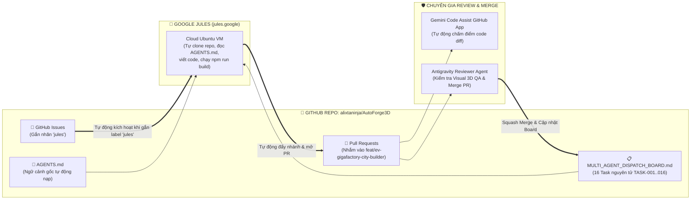

# HƯỚNG DẪN CÀI ĐẶT & PHỐI HỢP GOOGLE JULES AGENT + GEMINI CODE ASSIST TRÊN GITHUB (`GOOGLE_JULES_SETUP_GUIDE.md`)

> **Tóm tắt**: **Google Jules** (`https://jules.google`) là tác nhân lập trình bất đồng bộ (Asynchronous Autonomous Coding Agent) của Google chạy trên máy ảo đám mây (Cloud VM) riêng biệt và kết nối trực tiếp với GitHub.  
> Khi kết hợp **Google Jules** (nhận việc qua GitHub Issue / tạo PR tự động) + **Gemini Code Assist** (Review PR tự động trên GitHub) + **Antigravity** (Kiểm thử trực quan 3D, điều phối tổng thể & deploy), bạn sẽ có một **Đội ngũ Agent Xây dựng Thành phố 350Ha hoạt động 24/7 trên GitHub** mà không bao giờ bị mất ngữ cảnh!

---

## 1. KIẾN TRÚC PHỐI HỢP 3 LỚP GIỮA ANTIGRAVITY — GOOGLE JULES — GITHUB



---

## 2. CÁCH CÀI ĐẶT GOOGLE JULES KẾT NỐI VỚI REPO `AutoForge3D` (CHỈ MẤT 2 PHÚT)

### Bước 1: Kích hoạt Google Jules & Cấp quyền GitHub App
1. Truy cập trang chính thức của Google Jules tại: **`https://jules.google`** (đăng nhập bằng tài khoản Google của bạn).
2. Bấm **"Connect to GitHub account"**.
3. Trang cài đặt **Google Jules GitHub App** sẽ hiện ra:
   - Chọn tài khoản GitHub **`alixtaninja`**.
   - Chọn cấp quyền cho repository **`alixtaninja/AutoForge3D`** (hoặc *All repositories*).
   - Bấm **Install & Authorize**.

### Bước 2: Thiết lập Nhánh Làm Việc & Đọc Tự Động `AGENTS.md`
- Ngay khi kết nối xong, Google Jules sẽ **tự động phát hiện file [`/AGENTS.md`](../../AGENTS.md)** ở thư mục gốc của repo mà chúng ta vừa tạo!
- Nhờ có `/AGENTS.md`, mỗi khi Jules khởi tạo máy ảo (Cloud VM), nó đã biết sẵn:
  - Lệnh kiểm tra bắt buộc là `npm run build`.
  - Nhánh tính năng đích là `feat/ev-gigafactory-city-builder`.
  - Danh sách 16 Task nguyên tử nằm ở `docs/ev-gigafactory-blueprint/ATOMIC_TASK_SPECIFICATIONS.md`.

---

## 3. HAI CÁCH GIAO VIỆC (`TASK-001` .. `TASK-016`) CHO GOOGLE JULES

### Cách A: Giao việc Tự Động Ngay Trên GitHub Bằng Nhãn `jules` (Khuyên dùng!)
Google Jules hỗ trợ tính năng **Issue-to-PR tự động**:
1. Vào tab **Issues** trên GitHub của repo `alixtaninja/AutoForge3D` -> Bấm **New Issue** -> Chọn mẫu **"🤖 Giao Task Cho Google Jules / Coding Agent"** (đã được cài sẵn trong `.github/ISSUE_TEMPLATE/jules_agent_task.md`).
2. Điền mã Task (ví dụ `[TASK-006] Chế tạo bộ Three.js Twin Máy Công Trình Hạng Nặng`).
3. Gắn nhãn (**Label**) có tên là **`jules`** (chữ thường) vào Issue đó.
4. **Xong!** Ngay khi nhãn `jules` được gắn:
   - Google Jules sẽ tự động nhận thông báo từ GitHub, mở một phiên làm việc ngầm trên Cloud VM, đọc `AGENTS.md` và `ATOMIC_TASK_SPECIFICATIONS.md`.
   - Jules tự viết code `src/gigafactory/assets/heavyMachineryTwins.js`, tự chạy `npm run build` để kiểm tra không có lỗi.
   - Khi hoàn thành, Jules sẽ bình luận link tiến độ vào thẳng Issue và **tự động mở một Pull Request** để bạn hoặc Reviewer Agent kiểm tra!

> 💡 **Mẹo chạy song song nhiều Task trên Jules**:  
> Các Task độc lập về file như **`TASK-001`**, **`TASK-006`** (Máy công trình), **`TASK-007`** (Vật tư xây dựng) không phụ thuộc lẫn nhau. Bạn có thể giao đồng thời 3 Task này cho Google Jules chạy song song trên 3 Cloud VM cùng lúc!

---

### Cách B: Giao việc Trực Tiếp Từ Giao Diện Web `https://jules.google`
1. Mở `https://jules.google`.
2. Ở ô chọn Repository: Chọn **`alixtaninja/AutoForge3D`**.
3. Ở ô chọn Branch: Chọn nhánh **`feat/ev-gigafactory-city-builder`** (rất quan trọng để Jules nhánh ra từ đây và tạo PR về lại nhánh này).
4. Dán câu lệnh mẫu tương ứng với từng Task (xem danh sách Prompt copy-paste sẵn trong [`MULTI_AGENT_DISPATCH_BOARD.md`](./MULTI_AGENT_DISPATCH_BOARD.md)), ví dụ:
   ```text
   Read AGENTS.md and docs/ev-gigafactory-blueprint/ATOMIC_TASK_SPECIFICATIONS.md.
   Execute TASK-006 (build heavyMachineryTwins.js with 6 construction machinery Three.js Twins).
   Verify that `npm run build` succeeds with zero errors, update TASK-006 status in docs/ev-gigafactory-blueprint/MULTI_AGENT_DISPATCH_BOARD.md to IN_REVIEW, and publish the branch / create a PR targeting feat/ev-gigafactory-city-builder.
   ```
5. Bấm **"Give me a plan"** (hoặc bật Auto-approve plan) -> Khi Jules chạy xong, bấm **"Publish branch / Create PR"**.

---

## 4. CÀI ĐẶT AGENT CHUYÊN MÔN REVIEW & MERGE TỰ ĐỘNG TRÊN GITHUB

Để mọi Pull Request do Google Jules (hoặc các Agent khác) tạo ra đều được kiểm tra chất lượng tự động trước khi Merge, chúng ta kết hợp **3 lớp bảo vệ**:

### Lớp 1: GitHub Actions CI Tự Động Kiểm Tra Build & Cô Lập File (`.github/workflows/ci-agent-qa.yml`)
- Đã được thiết lập sẵn trong repo tại [`.github/workflows/ci-agent-qa.yml`](../../.github/workflows/ci-agent-qa.yml).
- Bất kỳ khi nào Jules hoặc một Agent tạo Pull Request vào `feat/ev-gigafactory-city-builder` hoặc `main`, GitHub Actions sẽ tự động chạy:
  1. `npm ci && npm run build` (Đảm bảo không vỡ bundle).
  2. Kiểm tra kích thước bundle và kiểm tra không có lỗi cú pháp.

### Lớp 2: Cài Đặt Google `Gemini Code Assist` Trên GitHub (Review Code Tự Động Miễn Phí)
1. Truy cập GitHub Marketplace: **`https://github.com/marketplace/gemini-code-assist`**
2. Bấm **Install it for free** -> Chọn tài khoản `alixtaninja` -> Chọn repo `AutoForge3D`.
3. Ngay khi Google Jules mở một Pull Request mới:
   - `gemini-code-assist[bot]` sẽ tự động nhảy vào PR trong vòng 30 giây, tóm tắt thay đổi và review từng dòng code (phát hiện lỗi rò rỉ bộ nhớ Three.js, quên dispose, hoặc sai logic tọa độ).
   - Bạn cũng có thể gõ `/gemini review` hoặc `/gemini summary` trong phần bình luận của bất kỳ PR nào.

### Lớp 3: Dùng Antigravity Làm `Principal_3D_QA_Reviewer_Agent` (Kiểm Định Hình Ảnh 3D & Merge)
- Vì dự án của chúng ta là **3D City-Builder trực quan**, ngoài việc code chạy được, chúng ta còn cần nhìn thấy mô hình 3D đẹp và đúng tỷ lệ thực tế.
- Sau khi Google Jules tạo PR xong, bạn chỉ cần mở Antigravity và nhắn:
  > *"Hãy review và merge các PR đang mở trên nhánh `feat/ev-gigafactory-city-builder` theo `REVIEW_AND_MERGE_PROTOCOL.md`"*
- Antigravity sẽ dùng `gh pr checkout`, dựng cảnh 3D trên máy ảo, dùng Puppeteer chụp ảnh thực tế mô hình vừa được Jules tạo ra để gửi bạn xem, rồi tự động `gh pr merge --squash` và cập nhật bảng điều phối!
