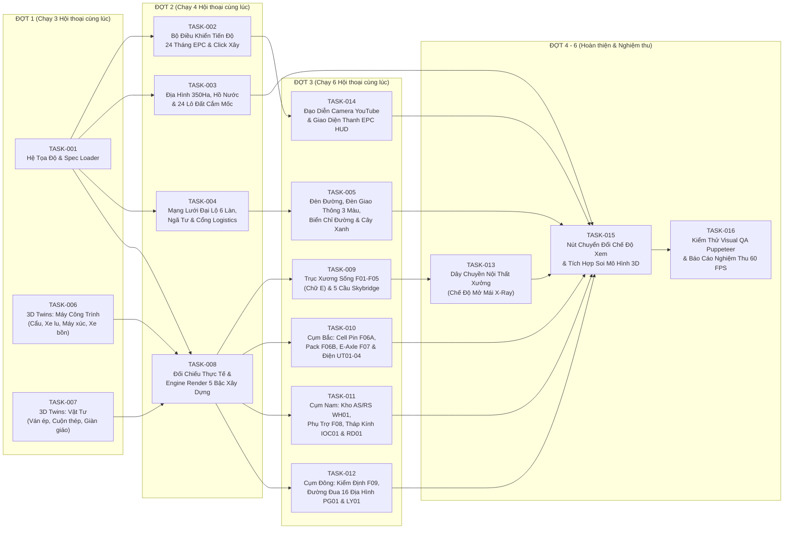

# BẢNG ĐIỀU PHỐI ĐA HỘI THOẠI QUA GITHUB (`MULTI_AGENT_DISPATCH_BOARD.md`)
## Dự án: EV Gigafactory 350 Ha — Industrial City-Builder & 24-Month EPC Time-Lapse Engine

> **Nhánh Tích Hợp Chính**: `feat/ev-gigafactory-city-builder`  
> **Tài liệu Ngữ Cảnh Gốc**: [`/AGENTS.md`](../../AGENTS.md)  
> **Công Cụ Điều Phối Không Đụng Độ (Zero-Conflict CLI)**: [`scripts/agent-coord.cjs`](../../scripts/agent-coord.cjs)  
> **Đặc Tả Kỹ Thuật 16 Task**: [`ATOMIC_TASK_SPECIFICATIONS.md`](./ATOMIC_TASK_SPECIFICATIONS.md)  
> **Quy Trình Review & Merge**: [`REVIEW_AND_MERGE_PROTOCOL.md`](./REVIEW_AND_MERGE_PROTOCOL.md)

---

## 1. CÁCH CHẠY NHIỀU HỘI THOẠI CÙNG LÚC MÀ KHÔNG BỊ TRÙNG TASK HAY XUNG ĐỘT GIT

Dự án đã được trang bị công cụ **`scripts/agent-coord.cjs`** và **16 tệp trạng thái độc lập** tại [`docs/ev-gigafactory-blueprint/status/`](./status/) kết hợp với khóa nhánh từ xa (`origin/task/TASK-xxx`):

1. **Khi bạn mở một Hội thoại Thực thi (Worker Conversation) mới**, bạn chỉ cần nhắn câu lệnh ngắn gọn sau:
   ```text
   Hãy đọc /AGENTS.md trong repo AutoForge3D, chạy `node scripts/agent-coord.cjs claim --auto` để nhận 1 task đang READY trên nhánh feat/ev-gigafactory-city-builder, thực hiện theo đúng ATOMIC_TASK_SPECIFICATIONS.md và chạy `node scripts/agent-coord.cjs submit <TASK_ID>` để mở PR khi hoàn thành.
   ```
   *(Nếu bạn muốn giao chỉ định một Task cụ thể, ví dụ `TASK-006`, chỉ cần đổi `--auto` thành `TASK-006`).*

2. **Khi bạn mở một Hội thoại Chuyên gia Review & Merge (Reviewer Conversation)**, bạn chỉ cần nhắn:
   ```text
   Hãy đọc /AGENTS.md và docs/ev-gigafactory-blueprint/REVIEW_AND_MERGE_PROTOCOL.md, chạy `node scripts/agent-coord.cjs review-list` để kiểm tra các PR đang chờ trên nhánh feat/ev-gigafactory-city-builder, chấm điểm 5 cổng QA và chạy `node scripts/agent-coord.cjs merge <PR_NUMBER> <TASK_ID>` cho các PR đạt chuẩn.
   ```

---

## 2. SƠ ĐỒ CÁC ĐỢT CHẠY SONG SONG (PARALLEL EXECUTION WAVES)



---

## 3. DANH SÁCH 16 TASK NGUYÊN TỬ & PHẠM VI FILE CÔ LẬP

> 💡 **Lưu ý**: Để xem trạng thái trực tiếp theo thời gian thực từ GitHub (gồm các nhánh `origin/task/TASK-*` và PR đang mở), luôn chạy lệnh:  
> `node scripts/agent-coord.cjs status`

| Mã Task | Đợt (Wave) | Tên Task & Mô Tả Ngắn | Phụ Thuộc | Các Tệp Tin Được Phép Tạo / Sửa (Isolated Scope) | File Trạng Thái Riêng |
|---|---|---|---|---|---|
| **[`TASK-001`](./ATOMIC_TASK_SPECIFICATIONS.md#-task-001-bộ-nạp-dữ-liệu-quy-hoạch--hệ-quy-chiếu-tọa-độ-masterspecloaderjs--constructionstagesspecjs)** | **Wave 1** | Bộ Nạp Dữ Liệu Quy Hoạch & Hệ Quy Chiếu Tọa Độ (`Smart Scenic Scale`) | *None* | `src/gigafactory/config/masterSpecLoader.js`<br>`src/gigafactory/config/constructionStagesSpec.js` | [`status/TASK-001.json`](./status/TASK-001.json) |
| **[`TASK-002`](./ATOMIC_TASK_SPECIFICATIONS.md#-task-002-bộ-quản-lý-tiến-độ-xây-dựng-24-tháng-epc--tương-tác-click-xây-từng-khu-constructiontimelinejs)** | **Wave 2** | Bộ Quản Lý Tiến Độ 24 Tháng EPC & Click Xây Từng Khu | `TASK-001` | `src/gigafactory/core/constructionTimeline.js` | [`status/TASK-002.json`](./status/TASK-002.json) |
| **[`TASK-003`](./ATOMIC_TASK_SPECIFICATIONS.md#-task-003-quy-hoạch-địa-hình-350-ha-hồ-điều-hòa--phân-lô-24-khu-đất-cắm-mốc-terrainandearthworkjs)** | **Wave 2** | Địa Hình 350 Ha, Hồ Điều Hòa & Phân Lô 24 Khu Đất Cắm Mốc | `TASK-001` | `src/gigafactory/infra/terrainAndEarthwork.js` | [`status/TASK-003.json`](./status/TASK-003.json) |
| **[`TASK-004`](./ATOMIC_TASK_SPECIFICATIONS.md#-task-004-mạng-lưới-đường-đại-lộ-6-làn-ngã-tư-vòng-xuyến--cổng-logistics-roadnetworkbuilderjs)** | **Wave 2** | Mạng Lưới Đường Đại Lộ 6 Làn, Ngã Tư, Vạch Kẻ & Cổng Logistics | `TASK-001` | `src/gigafactory/infra/roadNetworkBuilder.js` | [`status/TASK-004.json`](./status/TASK-004.json) |
| **[`TASK-005`](./ATOMIC_TASK_SPECIFICATIONS.md#-task-005-hạ-tầng-giao-thông-thông-minh--đèn-đường-đèn-tín-hiệu-3-màu-biển-chỉ-đường--cây-xanh-trafficpropsbuilderjs)** | **Wave 3** | Đèn Đường LED, Đèn Tín Hiệu 3 Màu, Biển Chỉ Đường & Cây Xanh (`InstancedMesh`) | `TASK-001`<br>`TASK-004` | `src/gigafactory/infra/trafficPropsBuilder.js` | [`status/TASK-005.json`](./status/TASK-005.json) |
| **[`TASK-006`](./ATOMIC_TASK_SPECIFICATIONS.md#-task-006-chế-tạo-bộ-threejs-twin-máy-công-trình-hạng-nặng-heavymachinerytwinsjs)** | **Wave 1** | Chế Tạo 6 Three.js Twin Máy Công Trình (Cẩu Tháp, Cẩu Xích, Xe Lu, Máy Xúc, Xe Ủi, Xe Bồn) | *None* | `src/gigafactory/assets/heavyMachineryTwins.js` | [`status/TASK-006.json`](./status/TASK-006.json) |
| **[`TASK-007`](./ATOMIC_TASK_SPECIFICATIONS.md#-task-007-chế-tạo-bộ-threejs-twin-vật-tư-xây-dựng--công-nghiệp-constructionmaterialstwinsjs)** | **Wave 1** | Chế Tạo 6 Three.js Twin Vật Tư (Ván Ép, Cuộn Thép, Dầm Chữ H, Cọc Bê Tông, Giàn Giáo) | *None* | `src/gigafactory/assets/constructionMaterialsTwins.js` | [`status/TASK-007.json`](./status/TASK-007.json) |
| **[`TASK-008`](./ATOMIC_TASK_SPECIFICATIONS.md#-task-008-nghiên-cứu-kiến-trúc-thực-tế--bộ-dựng-hình-5-giai-đoạn-thi-công-architectural_visual_referencemd--stagerendererjs)** | **Wave 2** | Hồ Sơ Kiến Trúc Thực Tế & Engine Render 5 Giai Đoạn Thi Công (`Stage 0..4`) | `TASK-001`<br>`TASK-006`<br>`TASK-007` | `docs/ev-gigafactory-blueprint/Architectural_Visual_Reference.md`<br>`src/gigafactory/builders/stageRenderer.js` | [`status/TASK-008.json`](./status/TASK-008.json) |
| **[`TASK-009`](./ATOMIC_TASK_SPECIFICATIONS.md#-task-009-thi-công-trục-xương-sống-sản-xuất-chính-f01f05--5-cầu-băng-tải-skybridge-sb-0105-spinefactoriesbuilderjs--skybridgesbuilderjs)** | **Wave 3** | Thi Công Trục Xương Sống `F01–F05` (Nhà Chữ E) & 5 Cầu `Skybridge SB-01..05` | `TASK-008` | `src/gigafactory/builders/spineFactoriesBuilder.js`<br>`src/gigafactory/builders/skybridgesBuilder.js` | [`status/TASK-009.json`](./status/TASK-009.json) |
| **[`TASK-010`](./ATOMIC_TASK_SPECIFICATIONS.md#-task-010-thi-công-cụm-phía-bắc--nhà-máy-cell-pin-f06a-pack-pin-f06b-động-cơ-f07--trạm-năng-lượng-ut01ut04-northenergybatterybuilderjs)** | **Wave 3** | Thi Công Cụm Bắc: Cell Pin `F06A`, Pack `F06B`, E-Axle `F07` & Trạm 220kV/BESS `UT01–04` | `TASK-008` | `src/gigafactory/builders/northEnergyBatteryBuilder.js` | [`status/TASK-010.json`](./status/TASK-010.json) |
| **[`TASK-011`](./ATOMIC_TASK_SPECIFICATIONS.md#-task-011-thi-công-cụm-phía-nam--kho-tự-động-wh01-5-xưởng-phụ-trợ-f08-15-tháp-điều-hành-ioc01--viện-rd01-southsupplierrdbuilderjs)** | **Wave 3** | Thi Công Cụm Nam: Kho AS/RS `WH01`, 5 Phụ Trợ `F08`, Tháp Kính 8 Tầng `IOC01` & `RD01` | `TASK-008` | `src/gigafactory/builders/southSupplierRdBuilder.js` | [`status/TASK-011.json`](./status/TASK-011.json) |
| **[`TASK-012`](./ATOMIC_TASK_SPECIFICATIONS.md#-task-012-thi-công-trung-tâm-kiểm-định-f09-đường-thử-16-địa-hình-pg01-38km--bãi-xe-điện-mặt-trời-ly01-easttestingyardbuilderjs)** | **Wave 3** | Thi Công Cụm Đông: Kiểm Định `F09`, Đường Đua 16 Địa Hình `PG01` (3.8km) & Bãi Xe `LY01` | `TASK-008` | `src/gigafactory/builders/eastTestingYardBuilder.js` | [`status/TASK-012.json`](./status/TASK-012.json) |
| **[`TASK-013`](./ATOMIC_TASK_SPECIFICATIONS.md#-task-013-dây-chuyền-sản-xuất-nội-thất-xưởng-khi-bật-chế-độ-mở-mái-xưởng-x-ray-interiorproductionlinesjs)** | **Wave 4** | Dây Chuyền Máy Móc Bên Trong Xưởng Khi Bật Chế Độ "Mở Mái Xưởng (X-Ray)" | `TASK-006`<br>`TASK-007`<br>`TASK-009` | `src/gigafactory/builders/interiorProductionLines.js` | [`status/TASK-013.json`](./status/TASK-013.json) |
| **[`TASK-014`](./ATOMIC_TASK_SPECIFICATIONS.md#-task-014-đạo-diễn-camera-livestream-youtube--giao-diện-điều-khiển-thành-phố-streamdirectorjs--gigafactoryuijs)** | **Wave 3** | Đạo Diễn Camera Livestream YouTube & Thanh Điều Khiển EPC HUD | `TASK-002` | `src/gigafactory/core/streamDirector.js`<br>`src/gigafactory/core/gigafactoryUI.js` | [`status/TASK-014.json`](./status/TASK-014.json) |
| **[`TASK-015`](./ATOMIC_TASK_SPECIFICATIONS.md#-task-015-tích-hợp-chuyển-đổi-chế-độ-xem-riverside-demo--gigafactory-350ha--đăng-ký-soi-mô-hình-3d-gigafactoryscenecontrollerjs-mainjs-modelinspectorjs)** | **Wave 5** | Tích Hợp Chuyển Đổi Chế Độ Xem ("Riverside" ↔ "Gigafactory 350Ha") & Soi Mô Hình 3D | `TASK-001`..<br>`TASK-014` | `src/gigafactory/gigafactorySceneController.js`<br>`src/main.js`, `src/modelInspector.js`, `index.html`, `src/style.css` | [`status/TASK-015.json`](./status/TASK-015.json) |
| **[`TASK-016`](./ATOMIC_TASK_SPECIFICATIONS.md#-task-016-kiểm-thử-tự-động-visual-qa-puppeteer-screenshots--nghiệm-thu-hiệu-năng-60-fps-toàn-tổ-hợp-visualauditrunnercjs)** | **Wave 6** | Kiểm Thử Tự Động Visual QA (Puppeteer Screenshots) & Báo Cáo Nghiệm Thu 60 FPS | `TASK-015` | `src/gigafactory/qa/visualAuditRunner.cjs`<br>`docs/ev-gigafactory-blueprint/QA_VISUAL_AUDIT_REPORT.md` | [`status/TASK-016.json`](./status/TASK-016.json) |
