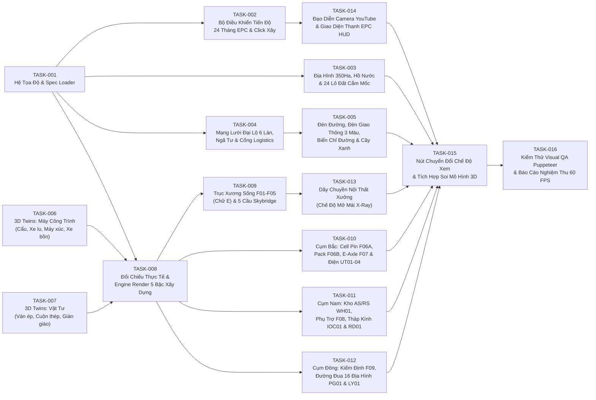

# BẢNG ĐIỀU PHỐI 16 TASK NGUYÊN TỬ ĐA TÁC NHÂN QUA GITHUB (`MULTI_AGENT_DISPATCH_BOARD.md`)
## Dự án: EV Gigafactory 350 Ha — Industrial City-Builder & 24-Month EPC Time-Lapse Engine

> **Nhánh Tích Hợp Chính (Integration Branch)**: `feat/ev-gigafactory-city-builder`  
> **Tài liệu Ngữ Cảnh Gốc (Root Context)**: [`/AGENTS.md`](../../AGENTS.md)  
> **Đặc Tả Kỹ Thuật Từng Task**: [`ATOMIC_TASK_SPECIFICATIONS.md`](./ATOMIC_TASK_SPECIFICATIONS.md)  
> **Quy Trình Review & Merge**: [`REVIEW_AND_MERGE_PROTOCOL.md`](./REVIEW_AND_MERGE_PROTOCOL.md)  
> **Hướng Dẫn Tích Hợp Google Jules**: [`GOOGLE_JULES_SETUP_GUIDE.md`](./GOOGLE_JULES_SETUP_GUIDE.md)

---

## 1. QUY TẮC TRẠNG THÁI (STATUS LEGEND)

| Ký hiệu | Trạng thái | Ý nghĩa |
|---|---|---|
| `⚪ TODO` | Chưa thực hiện | Sẵn sàng để Agent (Google Jules / Antigravity) nhận việc nếu các Task phụ thuộc đã `✅ MERGED` (hoặc `None`). |
| `🟡 IN_PROGRESS` | Đang thực thi | Một Agent đã tạo nhánh `task/TASK-xxx-*` (hoặc GitHub Issue gắn nhãn `jules`) và đang viết code. |
| `🟣 IN_REVIEW` | Chờ Review & Merge | Agent đã chạy `npm run build` PASS và mở Pull Request về `feat/ev-gigafactory-city-builder`. Chờ `Principal_3D_QA_Reviewer_Agent` duyệt. |
| `🔴 CHANGES_REQ` | Cần sửa lại | Reviewer Agent phát hiện lỗi Build, vượt ngân sách đa giác/Draw Calls hoặc chạm nhầm file ngoài phạm vi. |
| `✅ MERGED` | Đã hoàn tất | Đã được Reviewer Agent kiểm định 5 cổng QA và Squash Merge vào `feat/ev-gigafactory-city-builder`. |

---

## 2. SƠ ĐỒ PHỤ THUỘC GIỮA 16 TASK (DEPENDENCY GRAPH — CÁC LUỒNG CHẠY SONG SONG)



> 🚀 **Gợi ý Chạy Song Song Ngay Lập Tức (Wave 1)**:  
> **`TASK-001`**, **`TASK-006`**, và **`TASK-007`** hoàn toàn độc lập với nhau! Bạn có thể giao cả 3 Task này cùng lúc cho 3 phiên Google Jules / Antigravity mà không bao giờ bị đụng file.

---

## 3. BẢNG THEO DÕI TRẠNG THÁI 16 TASK NGUYÊN TỬ (MASTER TASK QUEUE)

| Mã Task | Tên Task & Mô Tả Ngắn | Phụ Thuộc | Các Tệp Tin Được Phép Tạo / Sửa (Isolated Scope) | Trạng Thái | Agent / Nhánh / PR | Reviewer & Commit |
|---|---|---|---|---|---|---|
| **[`TASK-001`](./ATOMIC_TASK_SPECIFICATIONS.md#-task-001-bộ-nạp-dữ-liệu-quy-hoạch--hệ-quy-chiếu-tọa-độ-masterspecloaderjs--constructionstagesspecjs)** | **Bộ Nạp Dữ Liệu Quy Hoạch & Hệ Quy Chiếu Tọa Độ (`Smart Scenic Scale`)** | *None* | `src/gigafactory/config/masterSpecLoader.js`<br>`src/gigafactory/config/constructionStagesSpec.js` | `⚪ TODO` | - | - |
| **[`TASK-002`](./ATOMIC_TASK_SPECIFICATIONS.md#-task-002-bộ-quản-lý-tiến-độ-xây-dựng-24-tháng-epc--tương-tác-click-xây-từng-khu-constructiontimelinejs)** | **Bộ Quản Lý Tiến Độ 24 Tháng EPC & Click Xây Từng Khu** | `TASK-001` | `src/gigafactory/core/constructionTimeline.js` | `⚪ TODO` | - | - |
| **[`TASK-003`](./ATOMIC_TASK_SPECIFICATIONS.md#-task-003-quy-hoạch-địa-hình-350-ha-hồ-điều-hòa--phân-lô-24-khu-đất-cắm-mốc-terrainandearthworkjs)** | **Địa Hình 350 Ha, Hồ Điều Hòa & Phân Lô 24 Khu Đất Cắm Mốc** | `TASK-001` | `src/gigafactory/infra/terrainAndEarthwork.js` | `⚪ TODO` | - | - |
| **[`TASK-004`](./ATOMIC_TASK_SPECIFICATIONS.md#-task-004-mạng-lưới-đường-đại-lộ-6-làn-ngã-tư-vòng-xuyến--cổng-logistics-roadnetworkbuilderjs)** | **Mạng Lưới Đường Đại Lộ 6 Làn, Ngã Tư, Vạch Kẻ & Cổng Logistics** | `TASK-001` | `src/gigafactory/infra/roadNetworkBuilder.js` | `⚪ TODO` | - | - |
| **[`TASK-005`](./ATOMIC_TASK_SPECIFICATIONS.md#-task-005-hạ-tầng-giao-thông-thông-minh--đèn-đường-đèn-tín-hiệu-3-màu-biển-chỉ-đường--cây-xanh-trafficpropsbuilderjs)** | **Đèn Đường LED, Đèn Tín Hiệu 3 Màu, Biển Chỉ Đường & Cây Xanh (`InstancedMesh`)** | `TASK-001`<br>`TASK-004` | `src/gigafactory/infra/trafficPropsBuilder.js` | `⚪ TODO` | - | - |
| **[`TASK-006`](./ATOMIC_TASK_SPECIFICATIONS.md#-task-006-chế-tạo-bộ-threejs-twin-máy-công-trình-hạng-nặng-heavymachinerytwinsjs)** | **Chế Tạo 6 Three.js Twin Máy Công Trình (Cẩu Tháp, Cẩu Xích, Xe Lu, Máy Xúc, Xe Ủi, Xe Bồn)** | *None* | `src/gigafactory/assets/heavyMachineryTwins.js` | `⚪ TODO` | - | - |
| **[`TASK-007`](./ATOMIC_TASK_SPECIFICATIONS.md#-task-007-chế-tạo-bộ-threejs-twin-vật-tư-xây-dựng--công-nghiệp-constructionmaterialstwinsjs)** | **Chế Tạo 6 Three.js Twin Vật Tư (Ván Ép, Cuộn Thép, Dầm Chữ H, Cọc Bê Tông, Giàn Giáo)** | *None* | `src/gigafactory/assets/constructionMaterialsTwins.js` | `⚪ TODO` | - | - |
| **[`TASK-008`](./ATOMIC_TASK_SPECIFICATIONS.md#-task-008-nghiên-cứu-kiến-trúc-thực-tế--bộ-dựng-hình-5-giai-đoạn-thi-công-architectural_visual_referencemd--stagerendererjs)** | **Hồ Sơ Kiến Trúc Thực Tế & Engine Render 5 Giai Đoạn Thi Công (`Stage 0..4`)** | `TASK-001`<br>`TASK-006`<br>`TASK-007` | `docs/ev-gigafactory-blueprint/Architectural_Visual_Reference.md`<br>`src/gigafactory/builders/stageRenderer.js` | `⚪ TODO` | - | - |
| **[`TASK-009`](./ATOMIC_TASK_SPECIFICATIONS.md#-task-009-thi-công-trục-xương-sống-sản-xuất-chính-f01f05--5-cầu-băng-tải-skybridge-sb-0105-spinefactoriesbuilderjs--skybridgesbuilderjs)** | **Thi Công Trục Xương Sống `F01–F05` (Nhà Chữ E) & 5 Cầu `Skybridge SB-01..05`** | `TASK-008` | `src/gigafactory/builders/spineFactoriesBuilder.js`<br>`src/gigafactory/builders/skybridgesBuilder.js` | `⚪ TODO` | - | - |
| **[`TASK-010`](./ATOMIC_TASK_SPECIFICATIONS.md#-task-010-thi-công-cụm-phía-bắc--nhà-máy-cell-pin-f06a-pack-pin-f06b-động-cơ-f07--trạm-năng-lượng-ut01ut04-northenergybatterybuilderjs)** | **Thi Công Cụm Bắc: Cell Pin `F06A`, Pack `F06B`, E-Axle `F07` & Trạm 220kV/BESS `UT01–04`** | `TASK-008` | `src/gigafactory/builders/northEnergyBatteryBuilder.js` | `⚪ TODO` | - | - |
| **[`TASK-011`](./ATOMIC_TASK_SPECIFICATIONS.md#-task-011-thi-công-cụm-phía-nam--kho-tự-động-wh01-5-xưởng-phụ-trợ-f08-15-tháp-điều-hành-ioc01--viện-rd01-southsupplierrdbuilderjs)** | **Thi Công Cụm Nam: Kho AS/RS `WH01`, 5 Phụ Trợ `F08`, Tháp Kính 8 Tầng `IOC01` & `RD01`** | `TASK-008` | `src/gigafactory/builders/southSupplierRdBuilder.js` | `⚪ TODO` | - | - |
| **[`TASK-012`](./ATOMIC_TASK_SPECIFICATIONS.md#-task-012-thi-công-trung-tâm-kiểm-định-f09-đường-thử-16-địa-hình-pg01-38km--bãi-xe-điện-mặt-trời-ly01-easttestingyardbuilderjs)** | **Thi Công Cụm Đông: Kiểm Định `F09`, Đường Đua 16 Địa Hình `PG01` (3.8km) & Bãi Xe `LY01`** | `TASK-008` | `src/gigafactory/builders/eastTestingYardBuilder.js` | `⚪ TODO` | - | - |
| **[`TASK-013`](./ATOMIC_TASK_SPECIFICATIONS.md#-task-013-dây-chuyền-sản-xuất-nội-thất-xưởng-khi-bật-chế-độ-mở-mái-xưởng-x-ray-interiorproductionlinesjs)** | **Dây Chuyền Máy Móc Bên Trong Xưởng Khi Bật Chế Độ "Mở Mái Xưởng (X-Ray)"** | `TASK-006`<br>`TASK-007`<br>`TASK-009` | `src/gigafactory/builders/interiorProductionLines.js` | `⚪ TODO` | - | - |
| **[`TASK-014`](./ATOMIC_TASK_SPECIFICATIONS.md#-task-014-đạo-diễn-camera-livestream-youtube--giao-diện-điều-khiển-thành-phố-streamdirectorjs--gigafactoryuijs)** | **Đạo Diễn Camera Livestream YouTube & Thanh Điều Khiển EPC HUD** | `TASK-002` | `src/gigafactory/core/streamDirector.js`<br>`src/gigafactory/core/gigafactoryUI.js` | `⚪ TODO` | - | - |
| **[`TASK-015`](./ATOMIC_TASK_SPECIFICATIONS.md#-task-015-tích-hợp-chuyển-đổi-chế-độ-xem-riverside-demo--gigafactory-350ha--đăng-ký-soi-mô-hình-3d-gigafactoryscenecontrollerjs-mainjs-modelinspectorjs)** | **Tích Hợp Chuyển Đổi Chế Độ Xem ("Riverside" ↔ "Gigafactory 350Ha") & Soi Mô Hình 3D** | `TASK-001`..<br>`TASK-014` | `src/gigafactory/gigafactorySceneController.js`<br>`src/main.js`, `src/modelInspector.js`, `index.html`, `src/style.css` | `⚪ TODO` | - | - |
| **[`TASK-016`](./ATOMIC_TASK_SPECIFICATIONS.md#-task-016-kiểm-thử-tự-động-visual-qa-puppeteer-screenshots--nghiệm-thu-hiệu-năng-60-fps-toàn-tổ-hợp-visualauditrunnercjs)** | **Kiểm Thử Tự Động Visual QA (Puppeteer Screenshots) & Báo Cáo Nghiệm Thu 60 FPS** | `TASK-015` | `src/gigafactory/qa/visualAuditRunner.cjs`<br>`docs/ev-gigafactory-blueprint/QA_VISUAL_AUDIT_REPORT.md` | `⚪ TODO` | - | - |

---

## 4. MẪU PROMPT COPY-PASTE ĐỂ GIAO VIỆC CHO BẤT KỲ AGENT NÀO (GOOGLE JULES / ANTIGRAVITY)

### A. Giao 1 Task cụ thể cho Coding Agent (Ví dụ `TASK-006`):
```text
Hãy đọc file /AGENTS.md, docs/ev-gigafactory-blueprint/MULTI_AGENT_DISPATCH_BOARD.md và docs/ev-gigafactory-blueprint/ATOMIC_TASK_SPECIFICATIONS.md trên nhánh feat/ev-gigafactory-city-builder.
Nhiệm vụ của bạn là thực hiện trọn vẹn TASK-006 (Chế tạo 6 Three.js Twin Máy Công Trình Hạng Nặng trong src/gigafactory/assets/heavyMachineryTwins.js).
Quy trình bắt buộc:
1. Tạo nhánh task/TASK-006-heavy-machinery-twins từ nhánh feat/ev-gigafactory-city-builder.
2. Viết code đúng hợp đồng hàm export và ngân sách đa giác quy định tại ATOMIC_TASK_SPECIFICATIONS.md.
3. Chạy `npm run build` để kiểm tra biên dịch không có lỗi.
4. Cập nhật dòng TASK-006 trong MULTI_AGENT_DISPATCH_BOARD.md sang trạng thái 🟣 IN_REVIEW, push nhánh và mở Pull Request về nhánh feat/ev-gigafactory-city-builder.
```

### B. Giao việc Review & Merge cho Specialist Reviewer Agent:
```text
Hãy đóng vai Principal_3D_QA_Reviewer_Agent theo đúng tài liệu docs/ev-gigafactory-blueprint/REVIEW_AND_MERGE_PROTOCOL.md.
Kiểm tra các Pull Request đang mở nhắm vào nhánh feat/ev-gigafactory-city-builder, chấm điểm 5 cổng QA (Scope Isolation, npm run build, 60 FPS Guardrails, Spatial/Visual Realism, Export Contract). Nếu đạt chuẩn, hãy approve, squash merge vào feat/ev-gigafactory-city-builder và cập nhật bảng MULTI_AGENT_DISPATCH_BOARD.md sang ✅ MERGED.
```
