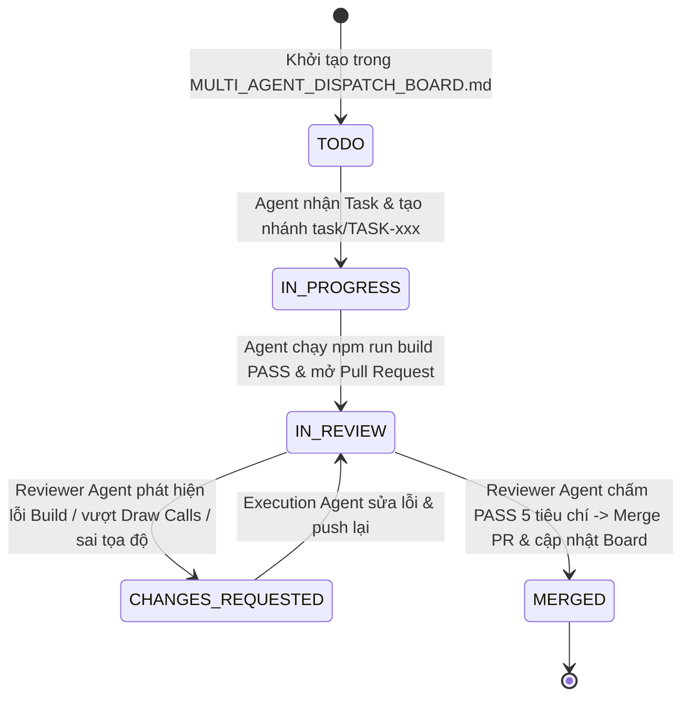

# GIAO THỨC REVIEW CHUYÊN MÔN & MERGE TỰ ĐỘNG DÀNH CHO AGENT (`REVIEW_AND_MERGE_PROTOCOL.md`)
## Vai trò: `Principal_3D_QA_Reviewer_Agent` (Specialist Code & 3D Architecture Reviewer)

> **Mục đích**: Khi một Execution Agent (Google Jules, Antigravity Subagent, hoặc một phiên làm việc độc lập) hoàn thành một `TASK-xxx` và tạo Pull Request (hoặc đẩy nhánh `task/TASK-xxx-*`), **Agent Chuyên Môn Review & Merge** sẽ thực hiện quy trình kiểm định 5 bước nghiêm ngặt dưới đây trước khi Merge vào nhánh `feat/ev-gigafactory-city-builder`.

---

## 1. SƠ ĐỒ VÒNG ĐỜI MỘT TASK (TASK LIFECYCLE STATE MACHINE)



- `⚪ TODO`: Chưa có Agent nhận.
- `🟡 IN_PROGRESS`: Đang được một Agent thực thi trên nhánh `task/TASK-xxx-*`.
- `🟣 IN_REVIEW`: Đã mở Pull Request vào `feat/ev-gigafactory-city-builder`, đang chờ `Principal_3D_QA_Reviewer_Agent` kiểm tra.
- `🔴 CHANGES_REQUESTED`: Cần chỉnh sửa theo nhận xét trên PR.
- `✅ MERGED`: Đã được Reviewer Agent duyệt, merge vào `feat/ev-gigafactory-city-builder` và ghi nhận mã commit.

---

## 2. CHECKLIST 5 TIÊU CHÍ CHẤM ĐIỂM CỦA REVIEWER AGENT (5-GATE QA RUBRIC)

Khi được gọi để review một Pull Request (ví dụ `PR #12` cho `TASK-006`), Reviewer Agent **bắt buộc** kiểm tra đủ 5 cổng sau:

### Cổng 1: Kiểm Tra Cô Lập Phạm Vi Tệp Tin (Scope Isolation Check)
- Chạy lệnh:
  ```bash
  gh pr diff <PR_NUMBER> --name-only
  ```
- **Tiêu chuẩn PASS**:
  - PR chỉ chạm vào đúng các file được cấp phép cho `TASK-xxx` trong [ATOMIC_TASK_SPECIFICATIONS.md](./ATOMIC_TASK_SPECIFICATIONS.md) (và dòng trạng thái tương ứng trong `MULTI_AGENT_DISPATCH_BOARD.md`).
  - Không làm hỏng hoặc xóa code của nhà máy `Riverside Demo` (`src/factoryBuilder.js`, `src/threejsTwins.js`).

### Cổng 2: Kiểm Tra Biên Dịch & Cú Pháp Module (Build & Export Contract Check)
- Checkout nhánh PR và chạy build thực tế:
  ```bash
  gh pr checkout <PR_NUMBER>
  npm run build
  ```
- **Tiêu chuẩn PASS**:
  - `vite build` thành công với `exit code 0`, không có lỗi thiếu import hoặc trùng biến.
  - Các hàm `export` khớp chính xác 100% tên hàm và cấu trúc tham số quy định trong [ATOMIC_TASK_SPECIFICATIONS.md](./ATOMIC_TASK_SPECIFICATIONS.md).

### Cổng 3: Kiểm Định Hiệu Năng WebGL & 60 FPS Guardrails (3D Performance Audit)
- Đọc diff code (`gh pr diff <PR_NUMBER>`) và kiểm tra:
  - **Không tự động nạp file `.glb` nặng**: Mọi hình khối trong cảnh chính phải là Pure Three.js (`THREE.Group`, `THREE.Mesh`, `THREE.InstancedMesh`).
  - **Sử dụng `THREE.InstancedMesh` hoặc `mergeGeometries`**: Các vật thể lặp lại nhiều lần (đèn đường, biển báo, cây xanh, cột thép chữ H, tấm pin mặt trời, cọc bê tông) không được tạo hàng trăm `new THREE.Mesh()` rời rạc gây nghẽn Draw Calls.
  - **Độ chi tiết hình học (Polygon Budget)**: Dùng `CylinderGeometry`, `BoxGeometry`, `ExtrudeGeometry` với số phân đoạn (`radialSegments = 8..16`) hợp lý, không vượt ngân sách tam giác của Task.

### Cổng 4: Kiểm Định Độ Chân Thực Công Nghiệp & Hệ Tọa Độ (Spatial & Visual Realism Audit)
- Kiểm tra việc sử dụng hàm chuyển đổi tọa độ `bpTo3JS()` / `bpBoundsTo3JS()` từ `masterSpecLoader.js`:
  - Đảm bảo trong Three.js trục thẳng đứng là **`Y`** (`y >= 0`), còn mặt đất phẳng là **`X - Z`**.
  - Các công trình đặc thù có đúng hình thái thực tế không (ví dụ: `F05` phải là hình chữ E, `F04` phải 3 tầng có ống khói RTO, `UT01` phải có sân trạm biến áp 220kV và dãy container BESS, `PG01` phải là đường đua Oval có góc nghiêng và làn thử).
  - Các mô hình máy công trình (Cẩu tháp, Xe lu, Máy xúc, Xe bồn) có đặt đáy tại `y = 0` và có màu sắc/tỷ lệ công nghiệp hợp lý không.

### Cổng 5: Cập Nhật Trạng Thái Đồng Bộ Trên GitHub (Board Synchronization)
- Sau khi 4 cổng trên đạt **PASS**:
  1. Đăng nhận xét Review chính thức lên PR:
     ```bash
     gh pr review <PR_NUMBER> --approve --body "✅ [Principal 3D QA Reviewer] Passed all 5 QA Gates (Scope, Build, 60FPS Guardrails, Spatial Realism, Export Contract). Ready to merge."
     ```
  2. Thực hiện Squash Merge vào nhánh `feat/ev-gigafactory-city-builder` và xóa nhánh phụ:
     ```bash
     gh pr merge <PR_NUMBER> --squash --delete-branch
     ```
  3. Cập nhật bảng `docs/ev-gigafactory-blueprint/MULTI_AGENT_DISPATCH_BOARD.md` trên nhánh `feat/ev-gigafactory-city-builder` sang trạng thái `✅ MERGED` kèm mã commit/PR.

---

## 3. CÂU LỆNH MẪU ĐỂ TRIỆU HỒI REVIEWER AGENT (PROMPT CHO REVIEWER SESSION)

Khi có 1 hoặc nhiều PR đang ở trạng thái `🟣 IN_REVIEW`, bạn chỉ cần mở một phiên Agent (hoặc gọi Subagent) và dán câu lệnh sau:

> **Prompt gọi Reviewer Agent**:
> ```text
> Hãy đóng vai Principal_3D_QA_Reviewer_Agent theo đúng tài liệu docs/ev-gigafactory-blueprint/REVIEW_AND_MERGE_PROTOCOL.md.
> 1. Kiểm tra danh sách các Pull Request đang mở nhắm vào nhánh feat/ev-gigafactory-city-builder bằng lệnh gh pr list.
> 2. Với từng PR, hãy kiểm tra 5 Cổng QA (Scope Isolation, npm run build, 3D Performance Guardrails, Spatial/Visual Realism, Export Contract) đối chiếu với docs/ev-gigafactory-blueprint/ATOMIC_TASK_SPECIFICATIONS.md.
> 3. Nếu đạt chuẩn, hãy gh pr review --approve, gh pr merge --squash --delete-branch và cập nhật trạng thái ✅ MERGED trong docs/ev-gigafactory-blueprint/MULTI_AGENT_DISPATCH_BOARD.md. Nếu chưa đạt, hãy comment chi tiết vị trí cần sửa.
> ```
